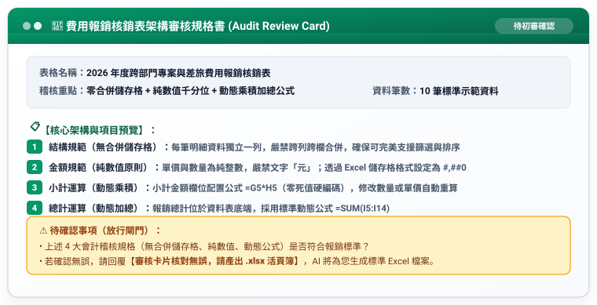

# 步驟 1-3：架構審核卡片與 Excel 範本生成提示詞

## 🛡️ 人機協商閘門：AI 產出的「費用報銷表架構審核卡片」

在生成最終 `.xlsx` 之前，AI 呈現審核規格書供人類核准：



---

## 💬 人類核准指令

```text
審核卡片核對無誤，請產出 .xlsx 活頁簿。
```

---

## 📥 落地產出

回覆後 AI 產出標準 Excel 活頁簿，學員可透過 Claude Artifacts、ChatGPT 下載，或由 Antigravity 透過 Python openpyxl 生成實體檔案。

完成成果請參閱：[**`部門差旅與專案費用報銷表_已完成.xlsx`**](./部門差旅與專案費用報銷表_已完成.xlsx)。

---

[← 返回步驟 1-2](./1-2_AI產出之RTCCF標準建表提示詞.md) ｜ [返回範例導覽](./README.md)
