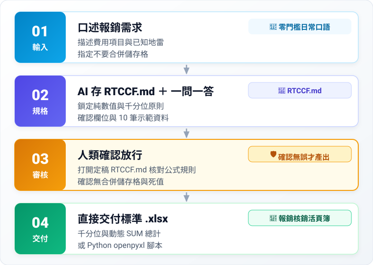

# 實戰範例 01：基礎建表與運算（告別排版地雷與公式語法）

> 🟢 **適用範圍**：通用於各主流 AI Agent（Web 對話介面與 Coding Agent）  
> 🛠️ **核心工作流**：**口語條列起手 ＋ `RTCCF.md` 輕量一問一答閉環**（口語條列 ➔ AI 存為 `RTCCF.md` 並用 2~3 題問答確認欄位與公式 ➔ 正式生成標準 Excel .xlsx）

---

## 📥 學員實戰素材與交付成品

- **核心交付成品**：
  - [**`部門差旅與專案費用報銷表_已完成.xlsx`**](./部門差旅與專案費用報銷表_已完成.xlsx) *(由 AI 自動建立之標準 Excel 活頁簿，無合併儲存格、含千分位格式與動態 SUM 總計公式)*

---

## 🏆 案例情境與業務痛點

非技術同仁在製作報銷表或各類清單時，最常踩入三大地雷被會計退件：
1. **隨意合併儲存格**：為了美觀把同部門合併，導致後續無法使用「資料篩選」與「排序」。
2. **文字干擾數值運算**：填入「NT$ 3,500 元」或夾帶「個/台/包」，導致 `=SUM()` 加總永遠是 0。
3. **計算機算死值硬編碼**：手動算好小計打上去，改了單價或數量，金額完全不會連動更新。

---

## ⚡ 人機協商工作流程（Human-in-the-Loop）



---

## 🛠️ 實戰演練：口語條列 ➔ AI 儲存 `RTCCF.md` ＋ 輕量一問一答 ➔ 實體 Excel

學員點進本頁即可直接複製步驟 1 提示詞上課實作（進階分步導覽：[1-1](./1-1_白話自然語言發想提示詞.md) ｜ [1-2](./1-2_AI產出之RTCCF標準建表提示詞.md) ｜ [1-3](./1-3_架構審核卡片與Excel範本生成提示詞.md)）：

### 步驟 1：日常口語條列輸入（零門檻起手）

將以下日常條列式需求複製發送給 AI：

```text
1. 我是專案行政人員，主管請我做一份「2026 年度部門差旅與專案費用報銷核銷表」，讓同仁填寫並給會計審查。
2. 以前做表常被會計退件，所以有幾個重點一定要避開：不要合併儲存格（會計要能篩選排序）、金額要填純數字不要夾帶「元」或「NT$」、小計跟總計一定要用公式自動算，順便幫我生 10 筆常見示範資料。
3. 先不要直接產出 Excel (.xlsx) 檔案！請先幫我整理成 RTCCF 規格書，並直接儲存為 Markdown 檔案（RTCCF.md）。
4. 小細節（像字體、千分位格式、公式語法）請你直接用專業經驗幫我填好，只要針對大方向（例如有哪些欄位、總計怎麼算）用「一問一答」跟我確認（一次問 1 題並給建議選項，不要問太細，最多問 2~3 題就好），每確認一題就幫我更新儲存 RTCCF.md！
```

---

### 步驟 2：與 AI 進行 2~3 題輕量一問一答（動態收斂 `RTCCF.md`）

因為每次對話脈絡不同，後續對話由現場互動決定，學員只需把握兩個重點：
1. **AI 自動建立首版 `RTCCF.md`**：送出後 AI 會先填好禁合併儲存格、純數值格式與公式語法等細節，並存為 `RTCCF.md`。
2. **回答 2~3 題大方向問題**：AI 會每次問 1 題（附建議選項 A/B/C，例如確認欄位清單與計算邏輯），學員只需選擇或簡單補充，AI 即同步更新儲存 `RTCCF.md`。

---

### 步驟 3：確認 `RTCCF.md` 定案 ➔ 下令生成標準 Excel (.xlsx)

回答完 2~3 題並打開確認定稿後的 `RTCCF.md` 無誤，發送放行指令：

```text
RTCCF.md 規格確認無誤，請正式產出 .xlsx 活頁簿！
```

- 📗 **示範產出參考**：[**`部門差旅與專案費用報銷表_已完成.xlsx`**](./部門差旅與專案費用報銷表_已完成.xlsx)
- 📥 **匯出方式**：可透過 Claude Artifacts、ChatGPT 直接下載，或由 Antigravity 以 Python `openpyxl` 生成標準實體 `.xlsx` 檔案。

---

[← 返回 Excel 全能實戰課程總導覽](../README.md)
