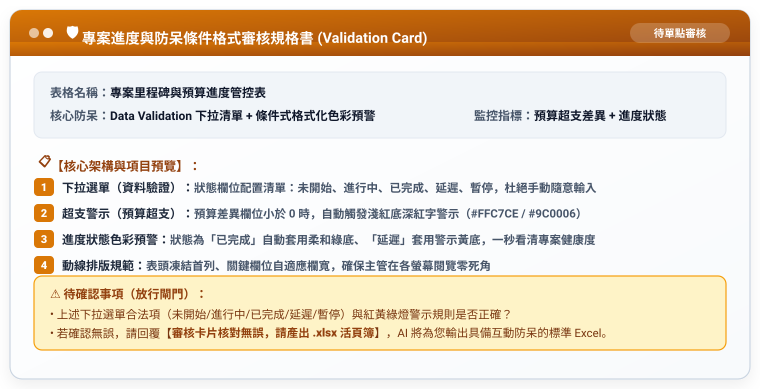

# 📑 步驟 2-2：AI 儲存 `RTCCF.md` 規格書 ＋ 輕量一問一答確認大方向

> **核心機制（Human-in-the-Loop 輕量問答）**：  
> AI 自動填好色碼與資料驗證規則等細節，產出並儲存為單一 **`RTCCF.md`**；並只針對欄位清單與警示條件用「一次 1 題＋建議選項（最多 2~3 題）」跟學員確認大方向。  
> 💡 **人機協作優勢**：每回答一題，AI 就同步更新儲存 **`RTCCF.md`**；確認定稿後即可放行生成 `.xlsx`，日後也能一鍵套用！

---

## 📋 AI 產出並儲存之 `RTCCF.md`（可供日後重用）

```markdown
# Role (角色定位)
你是一位專精於敏捷專案管理、商務流程風控與 Excel 企業級自動化設定的資深專案總監 (PMO Director)。

# Task (核心任務)
請為「2026 數位轉型專案里程碑與預算進度管控表 (Project Horizon)」建立具備防呆驗證與條件式色彩警示的標準活頁簿。包含：
1. 嚴格的資料庫二維表格結構。
2. 資料驗證（Data Validation）下拉選單設定。
3. 條件式格式設定（Conditional Formatting）色階與高亮規則。
4. 動態公式計算預算差異與加總。
5. 小細節依專業慣例自動補齊，先將本規格儲存為 `RTCCF.md`，並僅針對欄位清單與警示條件透過「一問一答（一次 1 題、附選項、最多 2~3 題）」確認，確認後同步更新 `RTCCF.md` 再產出標準活頁簿。

# Context (業務背景)
- 表格名稱：2026 數位轉型專案里程碑與預算進度管控表 (Project Horizon)
- 工作表名稱 (Sheet Name)：專案時程與預算管控表
- 基準日期：2026-04-30 ｜ 單位：新台幣 (NTD)
- 適用對象：跨部門專案成員回報進度，PMO 每週進行超支與延遲審查。

# Constraints & Risk Controls (防呆與警示規則)
1. 【資料驗證防呆（Data Validation）】：
   - 欄位：執行狀態（第 K 欄）
   - 限制類型：序列（List），僅允許輸入：`未開始,進行中,已完成,卡關延遲`。
   - 提示與錯誤警示：若使用者手動輸入其他字樣，Excel 需跳出警示彈窗：「請從下拉選單中選擇合法的執行狀態！」。
2. 【條件式格式化警示（Conditional Formatting）】：
   - 規則一【超支警示】：當「預算差異 (NT$)」< 0 時，該儲存格自動設定為淡紅色背景（#FFC7CE）搭配深紅色粗體字（#9C0006）。
   - 規則二【完工綠燈】：當「執行狀態」= "已完成" 時，自動設定為淡綠色背景（#C6EFCE）搭配深綠色字（#006100）。
   - 規則三【延遲警示】：當「執行狀態」= "卡關延遲" 時，自動設定為淡黃色背景（#FFEB9C）搭配深黃色字（#9C6500）。
3. 【公式動態連動】：
   - 預算差異 = `編列預算 - 實際支出`（公式 `=G4-H4`）。
   - 底部彙總列採用 `=SUM()` 自動加總總預算與總支出。

# Column Definitions (欄位定義)
- A 欄：任務編號（TSK-01 ~ TSK-06，文字置中）
- B 欄：所屬部門（IT處、產品處、行銷部、人資處，文字置中）
- C 欄：任務名稱（文字置左）
- D 欄：負責人（文字置中）
- E 欄：預計開始日（YYYY-MM-DD，文字置中）
- F 欄：預計完成日（YYYY-MM-DD，文字置中）
- G 欄：編列預算(NT$)（數值 `#,##0`，置右）
- H 欄：實際支出(NT$)（數值 `#,##0`，置右）
- I 欄：預算差異(NT$)（公式 `=G-H`，數值 `#,##0`，套用超支紅字條件式格式）
- J 欄：進度(%)（百分比格式 `0%`，置右）
- K 欄：執行狀態（資料驗證下拉選單，套用狀態顏色條件式格式）

# Format (輸出階段)
- 先儲存本 `RTCCF.md` 規格檔，並在對話中以「一問一答（一次 1 題、附選項、最多 2~3 題）」與學員確認下拉選單清單、條件格式觸發條件與 6 筆任務資料大方向，每回答一題即同步更新 `RTCCF.md`。
- 待學員確認定稿後的 `RTCCF.md` 無誤，再產出可直接下載的 .xlsx 檔案或 Python openpyxl 完整腳本。
```

---

## 🛡️ 一問一答確認大方向：防呆與條件警示預檢總覽



---

[← 上一步：步驟 2-1](./2-1_白話自然語言發想提示詞.md) ｜ [返回本階梯索引](./README.md) ｜ [下一步：步驟 2-3（確認 `RTCCF.md` 放行與匯出）➔](./2-3_防呆審核卡片與Excel範本生成提示詞.md)
