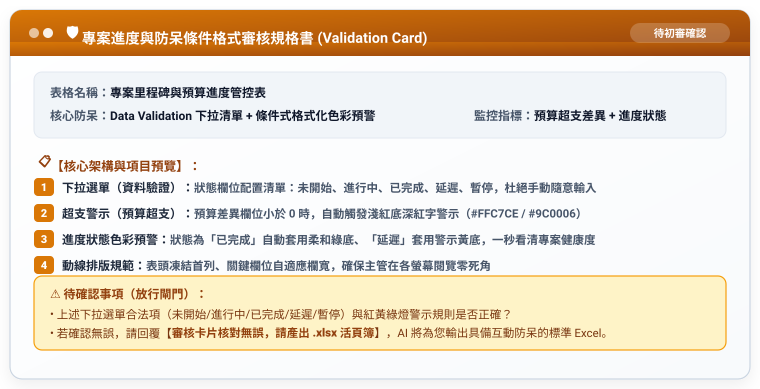

# 實戰範例 02：資料防呆與自動警示（告別手動檢查與眼花抓漏）

> 🟢 **適用範圍**：通用於各主流 AI Agent（Web 對話介面與 Coding Agent）  
> 🛠️ **核心工作流**：**雙階段 Markdown 審核閉環**（口語發想 ➔ 存為 `工作流.md` 初審 ➔ 產出 `規格書.md` 終審 ➔ 正式生成具備互動防呆之 Excel .xlsx）

---

## 📥 學員實戰素材與交付成品

- **核心交付成品**：
  - [**`專案里程碑與預算進度管控表_已完成.xlsx`**](./專案里程碑與預算進度管控表_已完成.xlsx) *(由 AI 自動建立之防呆 Excel，內含 K 欄互動下拉清單、負數超支紅字預警、完成綠底/延遲黃底條件式格式)*

---

## 🏆 案例情境與業務痛點

表格要發給多人填報時，最令主管頭痛的三大問題：
1. **輸入狀態五花八門**：同事填寫「OK」、「差不多」、「卡住」，後續完全無法分類統計。
2. **肉眼抓漏眼花看漏**：主管拿螢光筆在螢幕上一行行檢查誰超支、誰進度落後，耗時且容易漏看。
3. **條件格式設定層級深**：稍微選錯公式範圍或沒鎖定欄位 `$A1`，全表格式崩潰大跳色。

---

## ⚡ 人機協商工作流程（Human-in-the-Loop）


---

## 🛠️ 實戰演練：自然語言 ➔ RTCCF 交辦事項 ➔ 規格書 ➔ 實體 Excel

學員不必在多個檔案間切換，以下完整展示從白話日常口語到生成最終防呆 Excel 的完整流程：

### 步驟 1：日常自然語言輸入（零門檻口述需求）

學員只要在對話框中輸入日常白話：

```text
我想做一份「專案里程碑與預算進度管控表」給主管和專案成員用。
我希望進度狀態欄位只能用下拉選單挑選（未開始、進行中、已完成、延遲、暫停），不要讓大家自己亂打字。
另外，只要預算花費超過原本預算（差異小於 0），那一格就要自動變成淺紅底深紅字；進度寫已完成就變綠色、延遲就變黃色。
請先幫我把這段需求改寫成標準的 RTCCF 交辦事項（工作流），讓我儲存為 Markdown (.md) 檔案；並且先產出「防呆審核規格書」給我確認，不要直接輸出 Excel。待我確認 Markdown 內容與架構後，請再依照該檔為我正式生成具備資料驗證與條件格式的 .xlsx 檔案。
```

---

### 步驟 2：AI Agent 轉化為 RTCCF 交辦事項（⚠️ 強制儲存為 `工作流.md`）

AI Agent 接收口語後，自動結構化出標準交辦事項。**請學員第一時間將此內容儲存為 `專案防呆控管_工作流.md` 檔案**：

```markdown
## Role
資深專案管理顧問兼 Excel 自動化防呆架構師。

## Task
建立一份具備資料驗證（Data Validation）與條件式格式化（Conditional Formatting）的「專案里程碑與預算進度管控表」。

## Context
供團隊填寫里程碑進度與報銷花費，主管透過視覺化警示一眼識別風險。

## Constraint
1. 【下拉選單規範】：進度狀態欄位設置資料驗證清單（未開始、進行中、已完成、延遲、暫停）。
2. 【超支警示格式】：預算差異欄位小於 0 時，自動套用淺紅底深紅字警示。
3. 【狀態色彩預警】：已完成套用柔和綠底、延遲套用警示黃底。
4. 執行限制：【第一步必須先產出審核規格書】，待使用者核准後再輸出 .xlsx。
5. 語言：繁體中文，清楚規範。

## Format
欄位清單、下拉選單序列、條件式格式規則色碼。
```

> 👤 **人類初審**：使用者在本地或專案中檢視 `工作流.md`，確認合法狀態選項與警示色彩後傳給 AI 執行。

---

### 步驟 3：傳遞工作流 ➔ AI Agent 輸出「防呆與條件格式審核規格書」（⚠️ 亦存為 `規格書.md`）

AI Agent 接獲交辦事項後，先輸出防呆規則規格書供人類查核：



---

### 步驟 4：人類終審放行 ➔ 正式生成具備互動防呆之 Excel (.xlsx)

使用者人眼核對下拉合法項與條件格式色階無誤後，發送放行指令：

```text
審核卡片核對無誤，請產出 .xlsx 活頁簿。
```

AI Agent 立即依循規格書輸出標準 Excel 檔案：
- 📄 **完整示範成果**：請直接點閱參閱 [**`專案里程碑與預算進度管控表_已完成.xlsx`**](./專案里程碑與預算進度管控表_已完成.xlsx)。
- 📥 **取得方式**：Claude 可由右側 Artifacts 面板下載、ChatGPT 可直接點選下載連結，或由 Coding Agent 自動透過 Python openpyxl 產出實體活頁簿！

---

[← 返回 Excel 全能實戰課程總導覽](../README.md)
