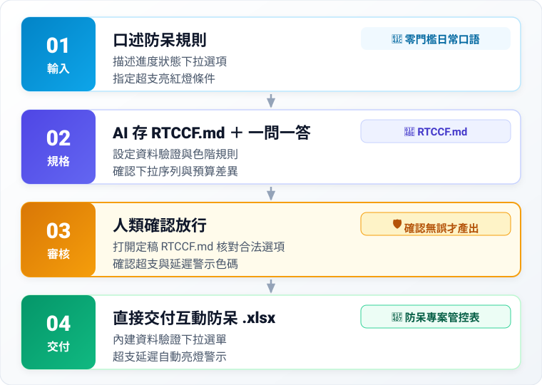

# 實戰範例 02：資料防呆與自動警示（告別手動檢查與眼花抓漏）

> 🟢 **適用範圍**：通用於各主流 AI Agent（Web 對話介面與 Coding Agent）  
> 🛠️ **核心工作流**：**口語條列起手 ＋ `RTCCF.md` 輕量一問一答閉環**（口語條列 ➔ AI 存為 `RTCCF.md` 並用 2~3 題問答確認防呆規則 ➔ 正式生成具備互動防呆之 Excel .xlsx）

---

## 📥 學員實戰素材與交付成品

- **隨附實戰素材**：
  - [**`素材_專案預算與進度管理需求規格草案.md`**](./素材_專案預算與進度管理需求規格草案.md)
- **核心交付成品**：
  - [**`專案里程碑與預算進度管控表_已完成.xlsx`**](./專案里程碑與預算進度管控表_已完成.xlsx) *(由 AI 自動建立之防呆 Excel，內含 K 欄互動下拉清單、負數超支紅字預警、完成綠底/延遲黃底條件式格式)*

---

## 🏆 案例情境與業務痛點

表格要發給多人填報時，最令主管頭痛的三大問題：
1. **輸入狀態五花八門**：同事填寫「OK」、「差不多」、「卡住」，後續完全無法分類統計。
2. **肉眼抓漏眼花看漏**：主管拿螢光筆在螢幕上一行行檢查誰超支、誰進度落後，耗時且容易漏看。
3. **條件格式設定層級深**：稍微選錯公式範圍或沒鎖定欄位 `$A1`，全表格式崩潰大跳色。

---

## ⚡ 人機協商工作流程（Human-in-the-Loop）



---

## 🛠️ 實戰演練：口語條列 ➔ AI 儲存 `RTCCF.md` ＋ 輕量一問一答 ➔ 防呆 Excel

學員點進本頁即可直接複製步驟 1 提示詞上課實作（進階分步導覽：[2-1](./2-1_白話自然語言發想提示詞.md) ｜ [2-2](./2-2_AI產出之RTCCF防呆與警示提示詞.md) ｜ [2-3](./2-3_防呆審核卡片與Excel範本生成提示詞.md)）：

### 步驟 1：日常口語條列輸入（零門檻起手）

將以下日常條列式需求複製發送給 AI（亦可附上 [`素材_專案預算與進度管理需求規格草案.md`](./素材_專案預算與進度管理需求規格草案.md)）：

```text
1. 我是專案經理，需要做一份「2026 數位轉型跨部門專案」的時程與預算管控表，同時附上 8~10 筆示範任務資料。
2. 以前發 Excel 給同事填常遇到兩大痛點：狀態大家亂填（我想改成只能用下拉選單選：未開始、進行中、已完成、卡關延遲），而且超支跟落後要用肉眼找（我希望「編列預算 - 實際支出 < 0」自動亮紅字警示、已完成亮綠底、卡關延遲亮黃底）。
3. 先不要直接產出 Excel (.xlsx) 檔案！請先幫我整理成 RTCCF 規格書，並直接儲存為 Markdown 檔案（RTCCF.md）。
4. 小細節（像色碼、條件式格式設定規則、資料驗證提示字）請你直接用專業經驗幫我填好，只要針對大方向（例如表格欄位、下拉選單選項與警示條件）用「一問一答」跟我確認（一次問 1 題並給建議選項，不要問太細，最多問 2~3 題就好），每確認一題就幫我更新儲存 RTCCF.md！
```

---

### 步驟 2：與 AI 進行 2~3 題輕量一問一答（動態收斂 `RTCCF.md`）

因為每次對話脈絡不同，後續對話由現場互動決定，學員只需把握兩個重點：
1. **AI 自動建立首版 `RTCCF.md`**：送出後 AI 會先填好色碼、資料驗證提示字與條件格式語法等細節，並存為 `RTCCF.md`。
2. **回答 2~3 題大方向問題**：AI 會每次問 1 題（附建議選項 A/B/C，例如確認欄位清單、下拉選單與警示條件），學員只需選擇或簡單補充，AI 即同步更新儲存 `RTCCF.md`。

---

### 步驟 3：確認 `RTCCF.md` 定案 ➔ 下令生成防呆 Excel (.xlsx)

回答完 2~3 題並打開確認定稿後的 `RTCCF.md` 無誤，發送放行指令：

```text
RTCCF.md 規格確認無誤，請正式產出 .xlsx 活頁簿！
```

- 📗 **示範產出參考**：[**`專案里程碑與預算進度管控表_已完成.xlsx`**](./專案里程碑與預算進度管控表_已完成.xlsx)
- 📥 **匯出方式**：可透過 Claude Artifacts、ChatGPT 直接下載，或由 Antigravity 生成具備下拉選單與動態變色之實體 `.xlsx` 活頁簿。

---

[← 返回 Excel 全能實戰課程總導覽](../README.md)
