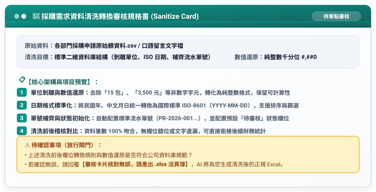

# 📑 步驟 3-2：AI 儲存 `RTCCF.md` 規格書 ＋ 輕量一問一答確認大方向

> **核心機制（Human-in-the-Loop 輕量問答）**：  
> AI 自動填好單位符號清理與 ISO 日期標準等細節，產出並儲存為單一 **`RTCCF.md`**；並只針對標準欄位與清洗邏輯用「一次 1 題＋建議選項（最多 2~3 題）」跟學員確認大方向。  
> 💡 **人機協作優勢**：每回答一題，AI 就同步更新儲存 **`RTCCF.md`**；確認定稿後即可放行生成 `.xlsx`，日後每月都能一鍵套用！

---

## 📋 AI 產出並儲存之 `RTCCF.md`（可供日後重用）

```markdown
# Role (角色定位)
你是一位資深企業營運資料工程師兼採購風控稽核專家，擅長處理非結構與半結構髒資料清洗。

# Task (核心任務)
請將各部門非結構化需求文字與半結構髒 CSV 進行端到端資料清洗與結構化，產出一份標準化活頁簿「各部門採購需求規範審核表.xlsx」。包含：
1. 資料欄位拆解與正規化（禁止合併資料儲存格）。
2. 文字與單位符號徹底剝除，數值還原為純整數（千分位格式）。
3. 日期格式統一為 ISO-8601（YYYY-MM-DD）。
4. 動態公式計算小計金額（=數量*單價）與總計。
5. 小細節依專業慣例自動補齊，先將本規格儲存為 `RTCCF.md`，並僅針對標準欄位與清洗邏輯透過「一問一答（一次 1 題、附選項、最多 2~3 題）」確認，確認後同步更新 `RTCCF.md` 再產出標準活頁簿。

# Context (業務背景)
- 表格名稱：2026 年度各部門採購需求審核與品管統計表
- 工作表名稱 (Sheet Name)：採購需求正規清單
- 來源資料：各部門 LINE 留言文字檔、Email 口語申請、以及夾帶文字單位之髒 CSV 數據。

# Sanitization & Cleansing Rules (極嚴格清洗規則)
1. 【去除字元雜訊】：
   - 數量欄：自動移除「台」、「包」、「支」、「個」、「套」、「組」，只保留純整數。
   - 單價欄：自動移除「NT$」、「$」、「元」、「TWD」及手動逗號，轉換為純數值。
2. 【日期標準化】：
   - 將「2026/4/10」、「2026年4月15日」、「民國115年4月12日」等格式一律校正為標準 `YYYY-MM-DD`。
3. 【動態公式配置】：
   - 「預估總金額 (NT$)」：嚴禁寫入死值，必須設定為公式 `=數量*單價`（例如 `=F4*G4`）。
   - 工作表底端必須使用 `=SUM()` 進行全案總預算統計。
4. 【規格補全】：
   - 為每筆採購配發統一編號：PR-2026-001 ~ PR-2026-010。
   - 審核狀態補齊預設值（例如：待審核、已核准）。

# Column Definitions (清洗後標準欄位)
- A 欄：採購單號 (PR No.)（PR-2026-001 起，文字置中）
- B 欄：申請日期（YYYY-MM-DD，文字置中）
- C 欄：申請部門（行銷部、研發處、管理部、資訊課等，文字置中）
- D 欄：申請人（文字置中）
- E 欄：採購品項說明（文字置左）
- F 欄：數量（純整數，數值格式 `#,##0`，置右）
- G 欄：預估單價(NT$)（純整數，數值格式 `#,##0`，置右）
- H 欄：預估總金額(NT$)（公式 `=F4*G4`，數值格式 `#,##0`，置右）
- I 欄：預計交付日（YYYY-MM-DD，文字置中）
- J 欄：急迫性（一般 / 急件，文字置中）
- K 欄：審核狀態（待審核 / 已核准，文字置中）

# Format (輸出階段)
- 先儲存本 `RTCCF.md` 規格檔，並在對話中以「一問一答（一次 1 題、附選項、最多 2~3 題）」與學員確認標準欄位與抽樣 3 筆清洗前後對比，每回答一題即同步更新 `RTCCF.md`。
- 待學員確認定稿後的 `RTCCF.md` 無誤，再產出可直接下載的 .xlsx 檔案或 Python openpyxl 完整腳本。
```

---

## 🛡️ 一問一答確認大方向：資料清洗前後對比預檢總覽



---

[← 上一步：步驟 3-1](./3-1_白話自然語言發想提示詞.md) ｜ [返回本階梯索引](./README.md) ｜ [下一步：步驟 3-3（確認 `RTCCF.md` 放行與匯出）➔](./3-3_數據清洗審核卡片與正規Excel匯出提示詞.md)
