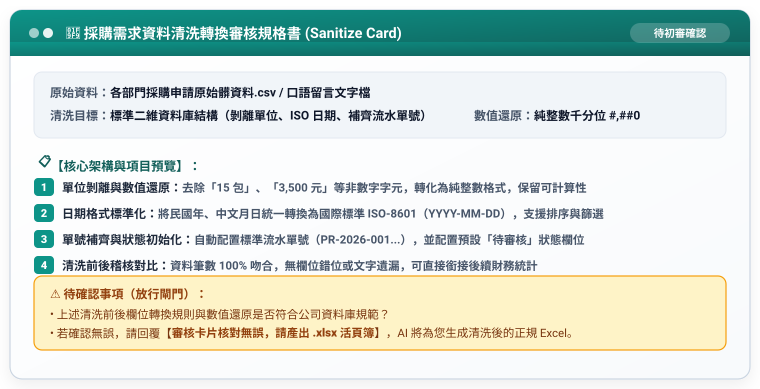

# 步驟 3-3：數據清洗審核卡片與正規 Excel 匯出提示詞

## 🛡️ 人機協商閘門：AI 產出的「採購需求清洗審核卡片」

在生成最終 `.xlsx` 之前，AI 呈現審核規格書供人類核准：



---

## 💬 人類核准指令

```text
審核卡片核對無誤，請產出 .xlsx 活頁簿。
```

---

## 📥 落地產出

回覆後 AI 產出清洗完成之標準 Excel 活頁簿。

完成成果請參閱：[**`各部門採購需求規範審核表_已完成.xlsx`**](./各部門採購需求規範審核表_已完成.xlsx)。

---

[← 返回步驟 3-2](./3-2_AI產出之RTCCF資料清洗與規範化提示詞.md) ｜ [返回範例導覽](./README.md)
