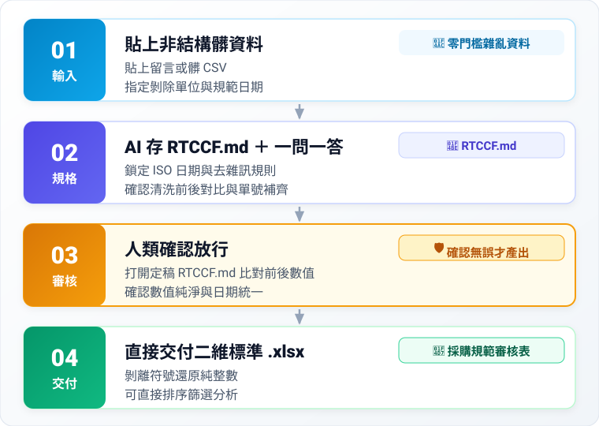

# 實戰範例 03：髒資料清洗與轉化（告別無止境複製貼上）

> 🟢 **適用範圍**：通用於各主流 AI Agent（Web 對話介面與 Coding Agent）  
> 🛠️ **核心工作流**：**口語條列 ＋ `RTCCF.md` 一問一答（5~6 題）➔ 直接交付 `.xlsx`**（貼上髒資料＋口語條列 ➔ AI 存為 `RTCCF.md` 並用 5~6 題問答確認清洗規則 ➔ 規格對了直接交付乾淨 Excel .xlsx）

---

## 📥 學員實戰素材與交付成品

- **隨附實戰素材**：
  - [**`素材_各部門零星採購需求未整理文字.txt`**](./素材_各部門零星採購需求未整理文字.txt) *(LINE 群組雜亂留言)*
  - [**`素材_各部門採購申請原始髒資料.csv`**](./素材_各部門採購申請原始髒資料.csv) *(夾帶單位符號的髒 CSV)*
- **核心交付成品**：
  - [**`各部門採購需求規範審核表_已完成.xlsx`**](./各部門採購需求規範審核表_已完成.xlsx) *(由 AI 自動清洗完成之標準資料庫型 Excel 活頁簿)*

---

## 🏆 案例情境與業務痛點

真實世界中的資料往往殘缺不全：
1. **非結構文字轉表格耗時**：收到主管在通訊軟體丟來的採購清單，只能一格格複製貼上。
2. **夾帶單位無法計算**：資料夾帶「15 包」、「3,500 元」，導致 Excel 無法運算。
3. **日期格式五花八門**：民國年、斜線、中文月日混雜，無法正常排序與篩選。

---

## ⚡ 人機協商工作流程（Human-in-the-Loop）



---

## 🛠️ 實戰演練：口語條列 ➔ AI 儲存 `RTCCF.md` ＋ 一問一答（5~6 題）➔ 直接交付 `.xlsx`

> 💡 **教學核心：不用複製貼上！掌握以下 6 個重點，用自己的口語條列寫出來，才真正學得會：**
> 1. **交代素材與目標**：上傳髒 CSV 與雜亂留言，整合成標準採購需求表。
> 2. **列出基本條件**：去單位變純數字、日期轉 `YYYY-MM-DD`、補單號與自動公式。
> 3. **要求先存 `RTCCF.md`**：先不要直接產出 `.xlsx`，先整理成 `RTCCF.md` 規格書存檔。
> 4. **小細節請 AI 先填**：千分位格式與清理哪些單位文字請 AI 先規劃好。
> 5. **大方向一問一答（約 5~6 題）**：一次問 1 題、附建議選項、不要問太細，最多問 5~6 題。
> 6. **邊問邊更新存檔**：每確認完一題，就同步更新儲存 `RTCCF.md`。

*(進階分步導覽：[3-1](./3-1_白話自然語言發想提示詞.md) ｜ [3-2](./3-2_AI產出之RTCCF資料清洗與規範化提示詞.md) ｜ [3-3](./3-3_數據清洗審核卡片與正規Excel匯出提示詞.md))*

### 步驟 1：依 6 個重點，上傳髒資料並用自己的口語條列輸入

上傳 [`素材_各部門採購申請原始髒資料.csv`](./素材_各部門採購申請原始髒資料.csv)（或搭配 [`素材_各部門零星採購需求未整理文字.txt`](./素材_各部門零星採購需求未整理文字.txt)），接著對照上面 6 個重點，用自己的口語簡短條列（以下為口語示範，每一列都簡短好懂）：

```text
1. 幫我把下面各部門 LINE 採購留言，連同上傳的髒 CSV 整合成標準採購表：
   - 行銷部 小張 羅技無線滑鼠 15 支，單價大概 650 元，2026/04/10 前要，急用。
   - 研發處 老王 Dell 27吋 4K 螢幕 2 台，每台 NT$ 13,500，2026-04-15 測試用。
   - 管理部 雅芬 影印紙 A4 30 包，一包 120，四月底前送到即可。
   - 資訊課 小李 網路交換器 1 台，報價 8,800 元，2026/04/12 到貨。
2. 單位文字要拿掉變純數字、日期統一 YYYY-MM-DD、補單號（PR-2026-001起）並用公式算金額。
3. 先不要直接產出 .xlsx，先幫我整理成 RTCCF 規格書並存成 RTCCF.md。
4. 小細節（像千分位、去除哪些單位）你先填好，大方向我們用一問一答確認。
5. 一次問我 1 題並給建議選項，不要問太細，最多問 5~6 題。
6. 每確認完一題，就幫我更新儲存一次 RTCCF.md。
```

---

### 步驟 2：與 AI 進行 5~6 題一問一答（用口語回覆收斂 `RTCCF.md`）

因為每批髒資料格式不同，後續問題由現場互動決定，學員只需把握兩個重點：
1. **AI 自動建立首版 `RTCCF.md`**：送出後 AI 會先填好單位符號剝除、ISO 日期校正與動態公式等細節，並存成 `RTCCF.md`。
2. **依重點用口語回答 5~6 題**：AI 會一次問 1 題並給選項（例如確認清洗後欄位清單、狀態預設值與例外處理），你只要用口語選選項或簡短補充，AI 即同步更新儲存 `RTCCF.md`。

---

### 步驟 3：確認 `RTCCF.md` 定案 ➔ 下令生成乾淨 Excel (.xlsx)

回答完 5~6 題並打開確認定稿後的 `RTCCF.md` 無誤，發送放行指令：

```text
RTCCF.md 規格確認無誤，請正式產出 .xlsx 活頁簿！
```

- 📗 **示範產出參考**：[**`各部門採購需求規範審核表_已完成.xlsx`**](./各部門採購需求規範審核表_已完成.xlsx)
- 📥 **匯出方式**：可透過 Claude Artifacts、ChatGPT 直接下載，或由 Antigravity 生成清洗完成之標準實體 `.xlsx` 活頁簿。

---

[← 返回 Excel 全能實戰課程總導覽](../README.md)
