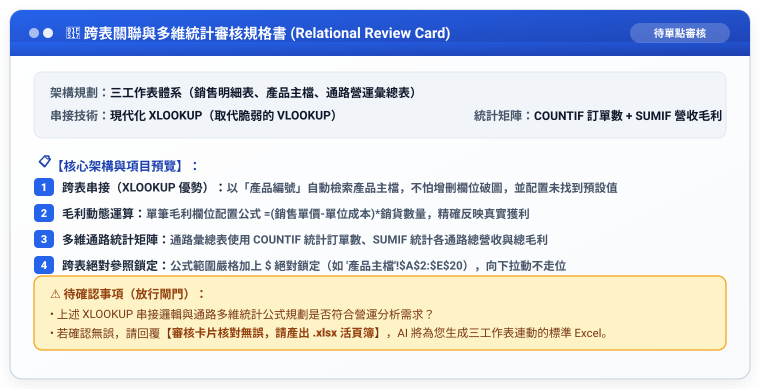

# 📑 步驟 4-2：AI 儲存 `RTCCF.md` 規格書 ＋ 輕量一問一答確認大方向

> **核心機制（Human-in-the-Loop 輕量問答）**：  
> AI 自動填好 XLOOKUP 與容錯語法等細節，產出並儲存為單一 **`RTCCF.md`**；並只針對三工作表架構與統計維度用「一次 1 題＋建議選項（最多 2~3 題）」跟學員確認大方向。  
> 💡 **人機協作優勢**：每回答一題，AI 就同步更新儲存 **`RTCCF.md`**；確認定稿後即可放行生成 `.xlsx`，日後也能一鍵套用！

---

## 📋 AI 產出並儲存之 `RTCCF.md`（可供日後重用）

```markdown
# Role (角色定位)
你是一位資深商業智慧 (BI) 架構師兼 Excel 進階函數專家，精通資料庫正規化設計與多表動態計算。

# Task (核心任務)
請建立一份標準活頁簿「2026多通路銷售毛利與跨表統計分析表.xlsx」，實現主檔與明細跨表動態檢索、毛利分析與統計匯總。包含三個 Sheet：
1. Sheet 1「產品成本主檔」：維護 6 款主力產品的標準定價與單位進貨成本。
2. Sheet 2「全通路銷售明細」：12 筆交易明細，透過 `=XLOOKUP()` 跨表動態檢索品名與成本，並以公式計算營收、成本與毛利。
3. Sheet 3「多維度營運統計匯總」：根據通路維度，使用 `=COUNTIF()` 與 `=SUMIF()` 動態匯總業績指標與平均毛利率。
4. 小細節依專業慣例自動補齊，先將本規格儲存為 `RTCCF.md`，並僅針對三工作表架構與統計維度透過「一問一答（一次 1 題、附選項、最多 2~3 題）」確認，確認後同步更新 `RTCCF.md` 再產出標準活頁簿。

# Formula & Calculation Constraints (嚴格公式與關聯限制)
1. 【XLOOKUP 動態關聯（禁止 VLOOKUP）】：
   - 產品名稱檢索：`=XLOOKUP(D4, 產品成本主檔!A:A, 產品成本主檔!B:B, "未知品項")`
   - 單位成本檢索：`=XLOOKUP(D4, 產品成本主檔!A:A, 產品成本主檔!E:E, 0)`
   - 杜絕硬編碼與 `#N/A` 報錯。
2. 【明細動態運算】：
   - 訂單總營收 = `數量 * 實銷單價`（公式 `=F4*G4`）
   - 訂單總成本 = `數量 * 單位成本`（公式 `=F4*I4`）
   - 訂單毛利 = `總營收 - 總成本`（公式 `=H4-J4`）
3. 【跨表匯總公式】：
   - 通路訂單筆數：`=COUNTIF(全通路銷售明細!C:C, A4)`
   - 通路總營收：`=SUMIF(全通路銷售明細!C:C, A4, 全通路銷售明細!H:H)`
   - 通路總毛利：`=SUMIF(全通路銷售明細!C:C, A4, 全通路銷售明細!K:K)`
   - 平均毛利率：`=總毛利 / 總營收`（公式 `=F4/D4`，格式為百分比 `0.0%`）
4. 【數值格式】：所有金額與數量統一為純數值加千分位 `#,##0`，毛利率為 `0.0%`。

# Format (輸出階段)
- 先儲存本 `RTCCF.md` 規格檔，並在對話中以「一問一答（一次 1 題、附選項、最多 2~3 題）」與學員確認三工作表架構、XLOOKUP 檢索邏輯與通路匯總數據，每回答一題即同步更新 `RTCCF.md`。
- 待學員確認定稿後的 `RTCCF.md` 無誤，再產出可直接下載的 .xlsx 檔案或 Python openpyxl 完整腳本。
```

---

## 🛡️ 一問一答確認大方向：跨表關聯與動態公式預檢總覽



---

[← 上一步：步驟 4-1](./4-1_白話自然語言發想提示詞.md) ｜ [返回本階梯索引](./README.md) ｜ [下一步：步驟 4-3（確認 `RTCCF.md` 放行與匯出）➔](./4-3_跨表關聯審核卡片與Excel範本生成提示詞.md)
