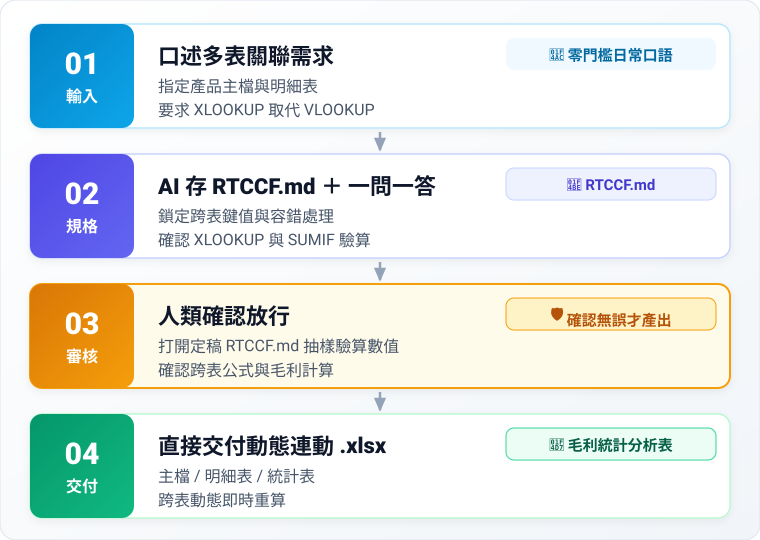

📍 [常見的 AI 應用](../../../README.md) › [辦公室全能應用](../../README.md) › [Excel 試算表](../README.md) › **階梯四：跨表關聯與多維統計**

# 實戰範例 04：跨表關聯與多維統計（告別 VLOOKUP 破圖與公式恐懼）

## 📥 學員實戰素材與交付成品

- **隨附實戰素材**：
  - [**`素材_2026第一季全通路銷售明細數據.csv`**](./素材_2026第一季全通路銷售明細數據.csv) *(訂單交易流水號)*
  - [**`素材_產品規格定價與成本主檔.csv`**](./素材_產品規格定價與成本主檔.csv) *(產品定價成本主檔)*
- **核心交付成品**：
  - [**`2026多通路銷售毛利與跨表統計分析表_已完成.xlsx`**](./2026多通路銷售毛利與跨表統計分析表_已完成.xlsx) *(由 AI 自動串接完成之三工作表 Excel 活頁簿，內含 XLOOKUP 跨表串接與 SUMIF 通路統計矩陣)*

---

## 🏆 案例情境與業務痛點

日常商業數據處理中，多表串接最常遇到三大痛苦：
1. **VLOOKUP 增刪欄位全破圖**：死記第幾欄，中間插入一欄公式全部報錯 `#REF!`。
2. **找不到資料出現刺眼 #N/A**：沒有處理例外值，版面雜亂且加總報錯。
3. **多通路手動篩選耗時**：每次有新訂單就要手動開篩選重新加總，無法動態連動。

---

## ⚡ 人機協商工作流程（Human-in-the-Loop）



---

## 🛠️ 實戰演練：口語條列 ➔ AI 儲存 `RTCCF.md` ＋ 一問一答（5~6 題）➔ 直接交付 `.xlsx`

> 💡 對照[章節總覽](../../README.md)的 **6 個口語重點**，用自己平時講話的方式簡短條列即可，不用複製貼上。

### 步驟 1：依 6 個重點，上傳 CSV 並用自己的口語條列輸入

上傳 `素材_2026第一季全通路銷售明細數據.csv` 與 `素材_產品規格定價與成本主檔.csv`，接著對照 6 個重點，用自己的口語簡短條列（以下為口語示範，每一列都簡短好懂）：

```text
1. 我上傳了「產品成本主檔」跟「全通路銷售明細」，想做成三個連動的 Excel 工作表。
2. 明細要用 XLOOKUP 帶出品名與成本（不要出現 #N/A），再做一張表依通路統計營收與毛利率。
3. 先不要直接產出 .xlsx，先幫我整理成 RTCCF 規格書並存成 RTCCF.md。
4. 小細節（像公式寫法、容錯預設值與千分位）你先填好，大方向我們用一問一答確認。
5. 一次問我 1 題並給建議選項，不要問太細，最多問 5~6 題。
6. 每確認完一題，就幫我更新儲存一次 RTCCF.md。
```

**🎯 預期 AI 回應重點**：
1. 肯定使用 `XLOOKUP` 代替傳統 `VLOOKUP` 的優勢（不怕增刪欄位、不受左右方向限制、自帶容錯）。
2. 自動填妥函數語法與容錯細節，直接產出並儲存單一 **`RTCCF.md`** 交付審核。
3. 透過「一問一答（附建議選項，最多 5~6 題）」跟學員口語確認三工作表結構與統計維度，每確認一題同步更新儲存 **`RTCCF.md`**。

---

### 步驟 2：與 AI 進行 5~6 題一問一答（用口語回覆收斂 `RTCCF.md`）

因為每次業務需求不同，後續問題由現場互動決定，學員只需把握兩個重點：
1. **AI 自動建立首版 `RTCCF.md`**：送出後 AI 會先填好 `XLOOKUP`、`SUMIF` 函數語法與防呆容錯細節，並存成 `RTCCF.md`。
2. **依重點用口語回答 5~6 題**：AI 會一次問 1 題並給選項（例如確認三工作表架構、容錯顯示值與統計維度），你只要用口語選選項或簡短補充，AI 即同步更新儲存 `RTCCF.md`。

---

### 步驟 3：確認 `RTCCF.md` 定案 ➔ 下令生成三表連動 Excel (.xlsx)

**🛡️ 先打開定稿 `RTCCF.md` 檢查兩點**：
1. **RTCCF 公式與關聯約束**：確認使用 `=XLOOKUP()`、`=COUNTIF()` 與 `=SUMIF()` 並具備未找到容錯預設值。
2. **跨表公式大方向**：抽樣驗算產品單價、單位成本帶出值與各通路營收／毛利匯總數字完全一致。

兩點都沒問題後，發送放行指令：

```text
RTCCF.md 規格確認無誤，請正式產出 .xlsx 活頁簿！
```

- 📗 **示範產出參考**：**`2026多通路銷售毛利與跨表統計分析表_已完成.xlsx`**
- 📥 **匯出方式**：可透過 Claude Artifacts、ChatGPT 直接下載，或由 Antigravity 生成具備 XLOOKUP 跨表串接之實體 `.xlsx` 活頁簿。

---

🧭 [⬅ 上一頁：階梯三：髒資料清洗與轉化](../03_階梯三_髒資料清洗與轉化_告別無止境複製貼上/README.md) ｜ [⬆ 回到：Excel 試算表](../README.md) ｜ [下一頁：階梯五：商業儀表板與視覺化 ➡](../05_階梯五_商業儀表板與視覺化_直上主管級商務看板/README.md)
