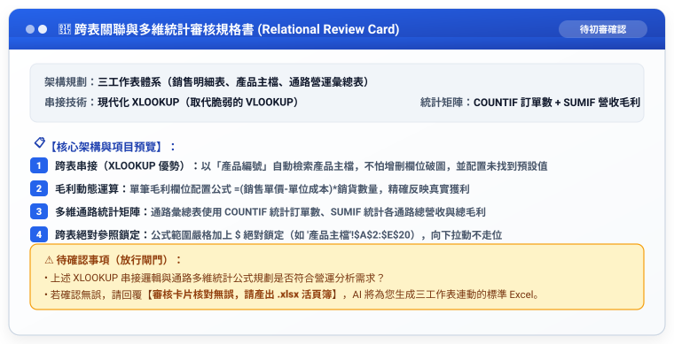

# 實戰範例 04：跨表關聯與多維統計（告別 VLOOKUP 破圖與公式恐懼）

> 🟢 **適用範圍**：通用於各主流 AI Agent（Web 對話介面與 Coding Agent）  
> 🛠️ **核心工作流**：**雙階段 Markdown 審核閉環**（口語發想 ➔ 存為 `工作流.md` 初審 ➔ 產出 `規格書.md` 終審 ➔ 正式生成三工作表連動之 Excel .xlsx）

---

## 📥 學員實戰素材與交付成品

- **隨附實戰素材**：
  - [**`素材_2026第一季全通路銷售明細數據.csv`**](./素材_2026第一季全通路銷售明細數據.csv) *(訂單交易流水號)*
  - [**`素材_產品規格定價與成本主檔.csv`**](./素材_產品規格定價與成本主檔.csv) *(產品定價成本主檔)*
- **核心交付成品**：
  - [**`2026多通路銷售毛利與跨表統計分析表_已完成.xlsx`**](./2026多通路銷售毛利與跨表統計分析表_已完成.xlsx) *(由 AI 自動串接完成之三工作表 Excel 活頁簿，內含 XLOOKUP 跨表串接與 SUMIF 通路統計矩陣)*

---

## 🏆 案例情境與業務痛點

日常商業數據處理中，多表串接最常遇到三大痛苦：
1. **VLOOKUP 增刪欄位全破圖**：死記第幾欄，中間插入一欄公式全部報錯 `#REF!`。
2. **找不到資料出現刺眼 #N/A**：沒有處理例外值，版面雜亂且加總報錯。
3. **多通路手動篩選耗時**：每次有新訂單就要手動開篩選重新加總，無法動態連動。

---

## ⚡ 人機協商工作流程（Human-in-the-Loop）


---

## 🛠️ 實戰演練：自然語言 ➔ RTCCF 交辦事項 ➔ 規格書 ➔ 實體 Excel

學員不必在多個檔案間切換，以下完整展示從白話日常口語到生成最終多表連動 Excel 的完整流程：

### 步驟 1：日常自然語言輸入（零門檻口述需求）

學員只要在對話框中輸入日常白話：

```text
我有兩張表：一張是「銷售明細」，裡面只有產品編號和數量；另一張是「產品主檔」，裡面有產品名稱、定價和成本。
我想用產品編號把名稱、定價和成本自動帶進明細表，不要用容易壞掉的 VLOOKUP，請用現代的 XLOOKUP，找不到時顯示「未知品項」。
並且在第三張工作表幫我做一份「通路營運分析表」，用 SUMIF 和 COUNTIF 自動統計官網、蝦皮、直營門市的訂單數、總營收和總毛利。
請先幫我把這段需求改寫成標準的 RTCCF 交辦事項（工作流），讓我儲存為 Markdown (.md) 檔案；並且先產出「跨表審核規格書」給我確認，不要直接輸出 Excel。待我確認 Markdown 內容與架構後，請再依照該檔為我正式生成三工作表連動的 .xlsx 檔案。
```

---

### 步驟 2：AI Agent 轉化為 RTCCF 交辦事項（⚠️ 強制儲存為 `工作流.md`）

AI Agent 接收口語後，自動結構化出標準交辦事項。**請學員第一時間將此內容儲存為 `跨表串接統計_工作流.md` 檔案**：

```markdown
## Role
資深商業智慧資料分析師兼 Excel 進階函數專家。

## Task
建立三工作表結構之「2026 多通路銷售毛利與跨表統計分析表」，完成 XLOOKUP 跨表關聯與通路多維統計。

## Context
整合銷售流水號與產品主檔，提供管理層精確之各通路獲利分析。

## Constraint
1. 【XLOOKUP 現代化關聯】：全面採用 XLOOKUP 關聯主檔，並設置未找到預設值。
2. 【毛利動態計算】：配置毛利公式 `=(銷售單價-單位成本)*銷貨數量`。
3. 【多維統計矩陣】：使用 COUNTIF 統計訂單數、SUMIF 統計各通路總營業額與總毛利。
4. 執行限制：【第一步必須先產出審核規格書】，待使用者核准後再輸出 .xlsx。
5. 語言：繁體中文，精準嚴謹。

## Format
工作表規劃、XLOOKUP 公式語法、SUMIF 統計矩陣定義。
```

> 👤 **人類初審**：使用者在本地或專案中檢視 `工作流.md`，確認關聯欄位與統計指標後傳給 AI 執行。

---

### 步驟 3：傳遞工作流 ➔ AI Agent 輸出「跨表關聯樞紐審核規格書」（⚠️ 亦存為 `規格書.md`）

AI Agent 接獲交辦事項後，先輸出跨表關聯規格書供人類查核：



---

### 步驟 4：人類終審放行 ➔ 正式生成多表連動 Excel (.xlsx)

使用者人眼核對 XLOOKUP 串接邏輯與通路統計矩陣無誤後，發送放行指令：

```text
審核卡片核對無誤，請產出 .xlsx 活頁簿。
```

AI Agent 立即依循規格書輸出標準 Excel 檔案：
- 📄 **完整示範成果**：請直接點閱參閱 [**`2026多通路銷售毛利與跨表統計分析表_已完成.xlsx`**](./2026多通路銷售毛利與跨表統計分析表_已完成.xlsx)。
- 📥 **取得方式**：Claude 可由右側 Artifacts 面板下載、ChatGPT 可直接點選下載連結，或由 Coding Agent 自動透過 Python openpyxl 產出實體活頁簿！

---

[← 返回 Excel 全能實戰課程總導覽](../README.md)
