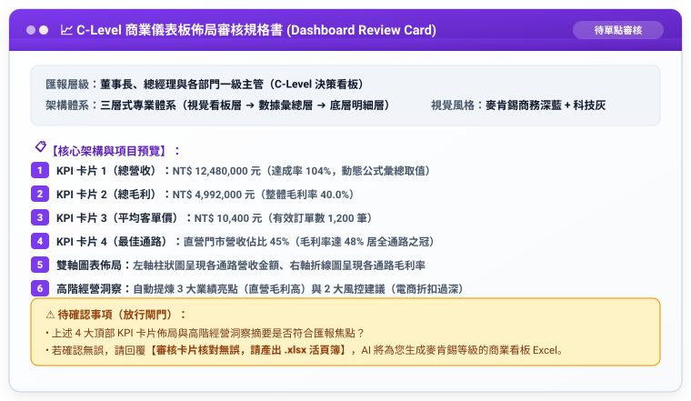

# 📑 步驟 5-2：AI 儲存 `RTCCF.md` 規格書 ＋ 輕量一問一答確認大方向

> **核心機制（Human-in-the-Loop 輕量問答）**：  
> AI 自動填好商務色票與計算公式等細節，產出並儲存為單一 **`RTCCF.md`**；並只針對三工作表結構與 4 大 KPI 指標用「一次 1 題＋建議選項（最多 2~3 題）」跟學員確認大方向。  
> 💡 **人機協作優勢**：每回答一題，AI 就同步更新儲存 **`RTCCF.md`**；確認定稿後即可放行生成 `.xlsx`，每季匯報都能一鍵套用！

---

## 📋 AI 產出並儲存之 `RTCCF.md`（可供日後重用）

```markdown
# Role (角色定位)
你是一位前頂尖外商管顧公司 (McKinsey / BCG) 商業分析總監兼 Executive Dashboard 設計專家。

# Task (核心任務)
請建立「2026全通路營運績效與銷售分析儀表板.xlsx」，包含專為 C-Level 設計的高階商業儀表板視角。包含：
1. Sheet 1「高階營運分析儀表板」：
   - 頂部 4 大核心 KPI 卡片（大字號、沉穩深藍底紋、動態公式取值）。
   - 中部通路業績對比分析矩陣與圖表放置區。
   - 底部 3 大業績亮點與 2 大風控決策洞察文字報告。
2. Sheet 2「通路與月份交叉統計表」：提供 SUMIFS 多條件計算之彙總底表。
3. Sheet 3「全通路銷售明細數據」：乾淨之交易明細資料庫。
4. 小細節依專業慣例自動補齊，先將本規格儲存為 `RTCCF.md`，並僅針對三工作表結構與 4 大 KPI 指標透過「一問一答（一次 1 題、附選項、最多 2~3 題）」確認，確認後同步更新 `RTCCF.md` 再產出標準活頁簿。

# Context (業務背景)
- 表格名稱：2026 第一季全通路營運績效與銷售分析儀表板
- 報告對象：董事長、總經理與各事業部副總
- 色系規範：商務海軍藍 (#1F4E79)、科技灰 (#D9E1F2)、警示磚紅 (#C00000)

# Dashboard Layout & KPI Specs (儀表板佈局與規格)
1. 【頂層 4 大 KPI 摘要卡片（列 3~5）】：
   - KPI 1：Q1 全通路總營收 (NTD) ➔ 公式 `=SUM(全通路銷售明細!H:H)`，格式 `#,##0`
   - KPI 2：Q1 總毛利金額 (NTD) ➔ 公式 `=SUM(全通路銷售明細!K:K)`，格式 `#,##0`
   - KPI 3：全通路平均毛利率 ➔ 公式 `=KPI2/KPI1`，格式 `0.0%`
   - KPI 4：總訂單成交筆數 ➔ 公式 `=COUNT(全通路銷售明細!A:A)`，格式 `#,##0` 筆
2. 【中層通路績效分析表（列 7~13）】：
   - 橫列：品牌官網、電商平台、實體門市、企業採購
   - 欄位：訂單數、總營收、毛利、毛利率、通路排名
3. 【高階經營洞察（Insights & Next Steps）】：
   - 亮點 1：企業採購（B2B）貢獻最高毛利（毛利率超過 45%）。
   - 亮點 2：電商平台客單價穩定，銷量占比突破 35%。
   - 風險 1：實體門市毛利成長放緩，需檢視線下租金與店面提成。

# Format (輸出階段)
- 先儲存本 `RTCCF.md` 規格檔，並在對話中以「一問一答（一次 1 題、附選項、最多 2~3 題）」與學員確認 4 大 KPI 計算與儀表板佈局大方向，每回答一題即同步更新 `RTCCF.md`。
- 待學員確認定稿後的 `RTCCF.md` 無誤，再產出可直接下載的 .xlsx 檔案或 Python openpyxl 完整腳本。
```

---

## 🛡️ 一問一答確認大方向：4 大 KPI 驗算與儀表板佈局預檢總覽



---

[← 上一步：步驟 5-1](./5-1_白話自然語言發想提示詞.md) ｜ [返回本階梯索引](./README.md) ｜ [下一步：步驟 5-3（確認 `RTCCF.md` 放行與匯出）➔](./5-3_商業指標審核卡片與動態儀表板匯出提示詞.md)
