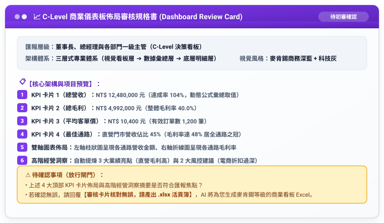

# 步驟 5-3：商業指標審核卡片與動態儀表板匯出提示詞

## 🛡️ 人機協商閘門：AI 產出的「商業儀表板審核卡片」

在生成最終 `.xlsx` 之前，AI 呈現審核規格書供人類核准：



---

## 💬 人類核准指令

```text
審核卡片核對無誤，請產出 .xlsx 活頁簿。
```

---

## 📥 落地產出

回覆後 AI 產出具備頂部 4 大 KPI 卡片與麥肯錫商務圖表之 Executive Dashboard 活頁簿。

完成成果請參閱：[**`2026全通路營運績效與銷售分析儀表板_已完成.xlsx`**](./2026全通路營運績效與銷售分析儀表板_已完成.xlsx)。

---

[← 返回步驟 5-2](./5-2_AI產出之RTCCF高階儀表板架構提示詞.md) ｜ [返回範例導覽](./README.md)
