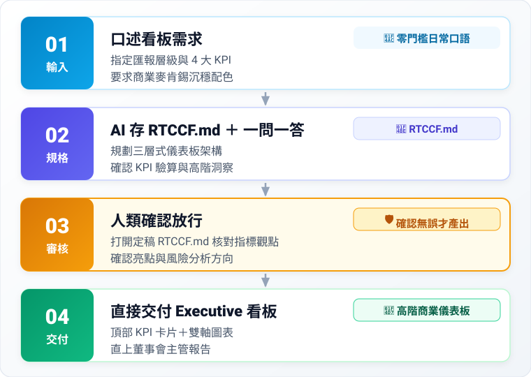

# 實戰範例 05：商業儀表板與視覺化（直上主管級商務看板）

> 🟢 **適用範圍**：通用於各主流 AI Agent（Web 對話介面與 Coding Agent）  
> 🛠️ **核心工作流**：**口語條列 ＋ `RTCCF.md` 一問一答（5~6 題）➔ 直接交付 `.xlsx`**（口語條列 ➔ AI 存為 `RTCCF.md` 並用 5~6 題問答確認 KPI 與版面 ➔ 規格對了直接交付商業儀表板 Excel .xlsx）

---

## 📥 學員實戰素材與交付成品

- **隨附實戰素材**：
  - [**`素材_2026多通路營運分析原始資料.xlsx`**](./素材_2026多通路營運分析原始資料.xlsx) *(多通路銷售底表)*
- **核心交付成品**：
  - [**`2026全通路營運績效與銷售分析儀表板_已完成.xlsx`**](./2026全通路營運績效與銷售分析儀表板_已完成.xlsx) *(由 AI 自動規劃之麥肯錫等級 Executive Dashboard，含頂部 4 大 KPI 卡片、雙軸營運圖表與高階商業洞察)*

---

## 🏆 案例情境與業務痛點

面對董事會、總經理與跨部門副總，上班族常踩入三大匯報雷區：
1. **滿螢幕呆板數字無人想看**：主管只有 10 秒時間，不想看一格格密密麻麻的小表格。
2. **圖表配色刺眼沒有商務感**：只會直接按預設插入圖表，紅配綠非常突兀，缺乏專業水準。
3. **缺乏高階經營洞察**：做完圖表答不出「所以這張圖代表什麼？」，無法給出經營決策建議。

---

## ⚡ 人機協商工作流程（Human-in-the-Loop）



---

## 🛠️ 實戰演練：口語條列 ➔ AI 儲存 `RTCCF.md` ＋ 一問一答（5~6 題）➔ 直接交付 `.xlsx`

> 💡 **教學核心：不用複製貼上！掌握以下 6 個重點，用自己的口語條列寫出來，才真正學得會：**
> 1. **交代主題與對象**：說明要給高層看的商業儀表板（如：給總經理看的 Q1 營運績效看板）。
> 2. **列出基本條件**：4 大 KPI 卡片、商務深藍雙圖表，以及「3 大亮點 ＋ 2 大風險」講稿。
> 3. **要求先存 `RTCCF.md`**：先不要直接產出 `.xlsx`，先整理成 `RTCCF.md` 規格書存檔。
> 4. **小細節請 AI 先填**：色系色碼、KPI 計算公式與排版細節請 AI 先規劃好。
> 5. **大方向一問一答（約 5~6 題）**：一次問 1 題、附建議選項、不要問太細，最多問 5~6 題。
> 6. **邊問邊更新存檔**：每確認完一題，就同步更新儲存 `RTCCF.md`。

*(進階分步導覽：[5-1](./5-1_白話自然語言發想提示詞.md) ｜ [5-2](./5-2_AI產出之RTCCF高階儀表板架構提示詞.md) ｜ [5-3](./5-3_商業指標審核卡片與動態儀表板匯出提示詞.md))*

### 步驟 1：依 6 個重點，上傳底表並用自己的口語條列輸入

上傳 [`素材_2026多通路營運分析原始資料.xlsx`](./素材_2026多通路營運分析原始資料.xlsx)，接著對照上面 6 個重點，用自己的口語簡短條列（以下為口語示範，每一列都簡短好懂）：

```text
1. 我上傳了多通路營運底表，要做給總經理與董事長看的「Q1 營運績效商業儀表板」。
2. 頂部要 4 大 KPI 卡片，中間放深藍商務風對比與趨勢圖，下面附「3 大亮點跟 2 大風險」講稿。
3. 先不要直接產出 .xlsx，先幫我整理成 RTCCF 規格書並存成 RTCCF.md。
4. 小細節（像色系色碼、KPI 公式、字體排版）你先填好，大方向我們用一問一答確認。
5. 一次問我 1 題並給建議選項，不要問太細，最多問 5~6 題。
6. 每確認完一題，就幫我更新儲存一次 RTCCF.md。
```

---

### 步驟 2：與 AI 進行 5~6 題一問一答（用口語回覆收斂 `RTCCF.md`）

因為每季營運重點不同，後續問題由現場互動決定，學員只需把握兩個重點：
1. **AI 自動建立首版 `RTCCF.md`**：送出後 AI 會先填好商務海軍藍色票、KPI 公式與三層式看板結構等細節，並存成 `RTCCF.md`。
2. **依重點用口語回答 5~6 題**：AI 會一次問 1 題並給選項（例如確認 4 大 KPI 指標、圖表版面與洞察重點），你只要用口語選選項或簡短補充，AI 即同步更新儲存 `RTCCF.md`。

---

### 步驟 3：確認 `RTCCF.md` 定案 ➔ 下令生成動態儀表板 (.xlsx)

回答完 5~6 題並打開確認定稿後的 `RTCCF.md` 無誤，發送放行指令：

```text
RTCCF.md 規格確認無誤，請正式產出 .xlsx 活頁簿！
```

- 📗 **示範產出參考**：[**`2026全通路營運績效與銷售分析儀表板_已完成.xlsx`**](./2026全通路營運績效與銷售分析儀表板_已完成.xlsx)
- 📥 **匯出方式**：可透過 Claude Artifacts、ChatGPT 直接下載，或由 Antigravity 生成具備頂部 KPI 卡片與商務圖表之實體 `.xlsx` 活頁簿。

---

[← 返回 Excel 全能實戰課程總導覽](../README.md)
