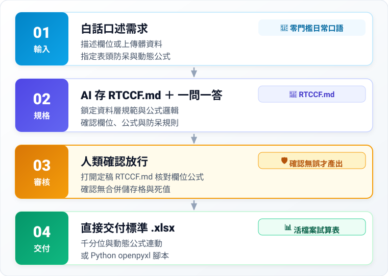

📍 [常見的 AI 應用](../../README.md) › [辦公室全能應用](../README.md) › **Excel 試算表**

# 📊 Excel (.xlsx) 試算表生成模組：五階漸進實戰指南
## 🚀 像學 Excel 一樣由淺入深：從「痛恨公式」到「指揮 AI 打造專業試算表」

> **模組核心教育哲學**：  
> 過去手動做一個標準的 Excel，學生必須背負沈重的觀念包袱——從避免合併儲存格、記憶複雜的公式語法（SUM/AVERAGE、IF 巢狀、VLOOKUP 鎖定 `$`）、到痛苦的髒資料清洗與圖表配色。很多學員學了幾週，依然做不出能交付主管的漂亮報表。  
> **在 AI 時代，學習路徑被徹底顛覆！學生只要懂一點點 Excel 的基礎概念，就能透過口語引導 AI 成為你的專屬試算表架構師。**  
> 本課程就像教 Excel 一樣，由淺入深設計了**「五大進階階梯」**，每一階都具備鮮明的【手動痛苦 vs. AI 賦能】強烈對比，讓學員每一堂課都「超級有感」！

---

## ⚡ 人機協作標準工作流（`RTCCF.md` 規格確認 ➔ 直接交付 `.xlsx`）

> 💡 **Excel 交付原則**：不需要中間的 `.md` 內文檔，只要 `RTCCF.md` 的欄位、公式與防呆規則確認無誤，就直接交付 `.xlsx`。

---

## 🗺️ Excel 漸進實戰能力地圖（前導思維 + 五大階梯）

---

## 📂 核心模組與五大階梯目錄速查

### 🧠 [00. 前導核心：AI 時代的 Excel 資料架構與審核心法](./00_前導核心_AI時代的Excel資料架構與審核心法/README.md)
- **傳統手動痛點**：盲目下指令「幫我做銷售表」，結果產出合併儲存格、死數字的廢表；公式壞掉完全不會抓漏。
- **AI 協作體驗**：具備架構師思維，能向 AI 開出專業規格書（分頁／欄位／公式／防呆），10 秒鐘拉樞紐驗收品質。
- **核心心法**：展示層與資料層分離（三種工作表角色）、乾淨資料「四不二要」黃金法則
- **架構辨識**：看懂 Excel 活檔案 vs. 死檔案、相對與絕對參照、四大核心函數家族
- **規格書 Prompt**：向 AI 開立規格書的「黃金四大維度」（Sheets、Schema、Formulas、Validation）
- **品管與驗收**：資料編輯列檢查、常見錯誤代碼（`#N/A`, `#REF!`, `#VALUE!`）排除、10 秒樞紐分析表品質驗證
- **教學設計**：四階段實戰教學法（反面教材體驗 ➔ 紙上架構設計 ➔ 結構 Prompt 產出 ➔ 打開驗收與分析）

### 🟢 [01. 階梯一：基礎建表與運算（告別排版地雷與公式語法）](./01_階梯一_基礎建表與運算_告別排版地雷與公式語法/README.md)
- **傳統手動痛點**：亂合併儲存格導致無法篩選；金額手打「元」導致 SUM 算不出來；小計打死值。
- **AI 協作體驗**：只要口述欄位需求，AI 自動規劃禁止合併的二維表格、純整數千分位格式與動態相乘／相加公式。
- **交付檔案**：📗 `部門差旅與專案費用報銷表_已完成.xlsx`

### 🟡 [02. 階梯二：資料防呆與自動警示（告別手動檢查與眼花抓漏）](./02_階梯二_資料防呆與自動警示_告別手動檢查與眼花抓漏/README.md)
- **傳統手動痛點**：同事狀態亂填無法統計；條件式格式層級深、鎖定欄位 `$A1` 容易搞錯；主管用肉眼找超支。
- **AI 協作體驗**：只要口述管理規則，AI 一鍵配置下拉選單與超支紅字、延遲黃底、完成綠底之條件格式化規則。
- **交付檔案**：📗 `專案里程碑與預算進度管控表_已完成.xlsx`

### 🟠 [03. 階梯三：髒資料清洗與轉化（告別無止境複製貼上）](./03_階梯三_髒資料清洗與轉化_告別無止境複製貼上/README.md)
- **傳統手動痛點**：LINE／Email 留言一行行手動複製貼上；舊 CSV 數字夾雜「台／包／元」無法加總；民國年混雜。
- **AI 協作體驗**：整段文字餵給 AI，語意自動拆解欄位，剝除文字單位保留純數值，日期統一校正為 `YYYY-MM-DD`。
- **交付檔案**：📗 `各部門採購需求規範審核表_已完成.xlsx`

### 🔵 [04. 階梯四：跨表關聯與多維統計（告別 VLOOKUP 破圖與公式恐懼）](./04_階梯四_跨表關聯與多維統計_告別VLOOKUP破圖與公式恐懼/README.md)
- **傳統手動痛點**：VLOOKUP 只能向右查、增刪欄位公式全爆、找不到報錯 `#N/A`；多條件統計參數老是記錯。
- **AI 協作體驗**：只要說明主檔與明細表關係，AI 自動撰寫強大穩健的 XLOOKUP，並自動架構多維度統計匯總表。
- **交付檔案**：📗 `2026多通路銷售毛利與跨表統計分析表_已完成.xlsx`

### 🟣 [05. 階梯五：商業儀表板與視覺化（直上主管級商務看板）](./05_階梯五_商業儀表板與視覺化_直上主管級商務看板/README.md)
- **傳統手動痛點**：插入圖表配色刺眼被主管罵；雙軸圖調不好；做完圖表答不出「這張圖代表什麼商業洞察」。
- **AI 協作體驗**：一句話生成麥肯錫等級沉穩色系儀表板、4 大 KPI 獨立卡片，AI 直接寫好「3 大亮點與 2 大風控」講稿！
- **交付檔案**：📗 `2026全通路營運績效與銷售分析儀表板_已完成.xlsx`

---

## 💡 Excel 試算表專業防坑五大鐵律（Pro Tips）

1. **嚴禁合併儲存格（No Merged Cells in Data Rows）**：
   - 資料列合併是 Excel 許多功能的殺手（無法排序、無法篩選、樞紐分析破圖）。透過 AI 規範每列獨立一筆記錄。
2. **純數值原則（Pure Numeric Values Only）**：
   - 金額欄位絕對不填入 `$`、`NT$`、`元`、`包`。貨幣與計量符號透過儲存格格式 `#,##0` 達成，保持運算彈性。
3. **跨表檢索首選 XLOOKUP（XLOOKUP > VLOOKUP）**：
   - 告別 VLOOKUP 的欄號限制與增刪欄位破壞，全面擁抱 XLOOKUP。
4. **零硬編碼計算（Formulas First）**：
   - 凡是小計、總計、差異、毛利率，一律使用公式動態運算，禁止填入靜態算好的死值。
5. **跨平台統一字型**：
   - 在 `RTCCF.md` 要求所有儲存格顯式套用 `Microsoft JhengHei`（或 `Noto Sans TC`），細節見章節總覽的「跨平台統一字型」。

---

🧭 [⬅ 上一頁：Word 與 PDF](../Word與PDF文件的生成/README.md) ｜ [⬆ 回到：辦公室全能應用](../README.md) ｜ [下一頁：PowerPoint 簡報 ➡](../簡報的生成/README.md)
