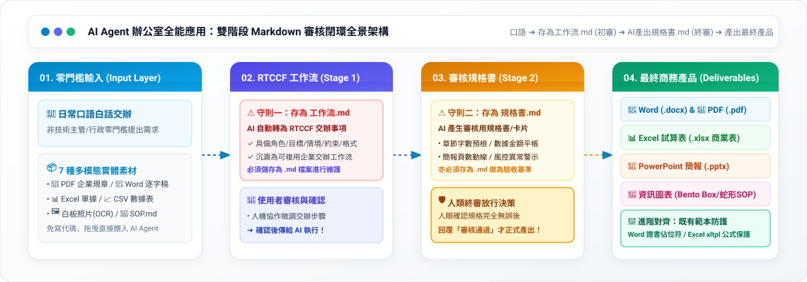

# 辦公室全能應用：五大商務交付格式生成手冊
## 🚀 AI Agent 人機協作實戰

> **本模組簡介**：本專題專為現代職場與辦公室非技術人員量身設計，徹底擺脫對單一工具的依賴。核心工作流通用於各類主流 AI Agent。
> 
> 針對初學者「不會寫 Prompt、擔心 AI 產出不可控、格式無法直接交付」的三大痛點，本教學全面導入 **雙階段 Markdown 審核閉環機制（Human-in-the-Loop）**：
> 1. **零門檻口語生成 RTCCF 工作流**：學員輸入日常口語，AI Agent 自動將需求規格化為專業的「RTCCF 交辦事項（工作流）」。
> 2. **【核心守則一】工作流必須儲存為 Markdown (.md) 檔案**：將 RTCCF 工作流儲存為 `.md` 檔案（如 `RTCCF工作流.md`），使用者進行初審與確認。
> 3. **傳遞工作流 ➔ AI 產出審核規格書**：使用者確認後將 RTCCF 交辦事項傳給 AI Agent，AI Agent 預檢並產生「審核用規格書（審核卡片）」。
> 4. **【核心守則二】規格書亦必須儲存為 Markdown (.md) 檔案**：審核規格書同樣必須儲存為 `.md` 檔案（如 `交付規格書.md`），作為最終驗收與防幻覺基準。
> 5. **人類最終核准 ➔ 生成最終商務產品**：經使用者二次確認「可以了 / 審核通過」，AI Agent 才正式匯出 **Word (.docx)**、**Excel (.xlsx)**、**PowerPoint (.pptx)**、**PDF (.pdf)** 以及 **全自動資訊圖表（Infographic）**！

## 🧭 AI Agent 辦公室人機協作全景架構（Human-in-the-Loop）

本手冊全面導入 **雙階段 Markdown 審核閉環機制**，確保 AI 產出完全受控、不跑版、符合企業實務標準：
1. **零門檻輸入 (Input Layer)**：支援日常口語交辦，以及 PDF、Word、Excel、CSV、白板照片（OCR）等 7 大多模態實體素材。
2. **AI 規格化 ➔ 儲存 `RTCCF工作流.md` (Stage 1)**：AI Agent 自動將需求架構化為 RTCCF 交辦事項，**強制存為 `.md` 檔**，經人類審核確認後再交付執行。
3. **AI 產生規格書 ➔ 儲存 `交付規格書.md` (Stage 2)**：AI 預檢並產出審核規格書（含章節、欄位、金額平帳、版面動線），**亦強制存為 `.md` 檔**，由人類進行最終放行決策。
4. **正式生成最終產品 (Deliverables Hub)**：經雙重審核確認「可以了」後，才正式產出 Word、Excel、PPT、PDF、資訊圖表與進階對齊樣版。

---

## 📌 關鍵核心原則：為什麼人機協作的「工作流」與「規格書」必須雙雙儲存為 Markdown (.md) 檔案？

在與 AI Agent 進行深度人機協作時，**「將 RTCCF 工作流（交辦事項）與審核規格書儲存為 Markdown 檔案 (`.md`)」是企業級協作不可妥協的最佳實踐**：

| 評估面向 | 儲存為 Markdown (`.md`) | 存為一般記事本 (`.txt`) | 存為 Word (`.docx`) |
| :--- | :--- | :--- | :--- |
| **語意結構保真度** | 🟢 **100% 原生解析**：保留 `#` 標題、`\| 表格 \|`、代碼區塊與縮排層級，AI Agent 精準理解任務角色、欄位邊界與約束條件。 | 🟡 **結構模糊**：僅有平鋪文字，複雜的交辦步驟、參數對齊容易錯位，AI Agent 容易漏看約束。 | 🔴 **格式污染**：夾帶大量二進位與 XML 富文本標籤，複製到對話介面時引發格式錯亂與雜訊。 |
| **AI Agent 相容性** | 🟢 **完美通用**：主流 AI Agent 原生皆以 Markdown 渲染與解析，直接讀取 `.md` 工作流能做到**零幻覺精準執行**。 | 🟡 段落切分較生硬，跨段落檢索容易斷層。 | 🟡 檔案體積大，上傳與解析耗時較久，部分平台解析表格易變形。 |
| **人機協作與版本控管** | 🟢 **最佳數位資產**：支援 Git、VS Code、Obsidian，團隊可多人協作修訂交辦事項，作為企業永久調用的 SOP 資產庫。 | 🔴 缺乏結構化，難以建立可追蹤、可擴充的工作流資產庫。 | 🔴 難以進行純文字 diff 版本比較與自動化管道調用。 |

> 💡 **雙階段操作原則**：
> 1. **初審階段（工作流存檔）**：每次 AI Agent 將你的口語需求改寫為 RTCCF 交辦事項後，**請第一時間複製並在本地或專案中儲存為工作流檔案（例如：`採購單據清洗_工作流.md`）**，經人眼確認交辦步驟後再傳給 AI 執行。
> 2. **終審階段（規格書存檔）**：AI Agent 產出的審核卡片與預檢內容，**亦儲存為規格書檔案（例如：`採購單據清洗_規格書.md`）**，作為品質驗收與防呆基準，待核對無誤後才允許生成最終實體產品。

---

## 📂 核心生成格式與教學手冊

> 💡 點選下方各模組即可進入對應的實戰教學、素材與雙階段範本檔案：

### 📄 01. Word (.docx) 與 PDF (.pdf) 文件生成
- **核心教學模組**：[**Word與PDF文件的生成/**](./Word與PDF文件的生成/README.md)
- **審核規格書機制**：文件架構規格書（預檢章節骨架、字數規劃、法規與合規警示）
- **核心實戰場景**：
  - **專案企劃書與推動計畫**：口語發想 ➔ AI 產出 RTCCF 交辦事項（存為 `工作流.md` 初審）➔ 交付 AI 產出章節規格書（存為 `規格書.md` 終審）➔ 正式匯出 `.docx`
  - **差旅規章萃取員工指南**：上傳內部 [差旅管理規範.pdf](./Word與PDF文件的生成/02_企業差旅規章萃取員工指南/素材_企業內部規章_差旅與加班管理規範.pdf) ➔ AI 提煉權益工作流 ➔ 產出合規審核規格書 ➔ 產出易讀員工指南

### 📊 02. Excel (.xlsx) 試算表生成（前導心法＋五大階梯）
- **核心教學模組**：[**Excel試算表的生成/**](./Excel試算表的生成/README.md)
- **審核規格書機制**：數據與風控規格書（預檢欄位結構、列數、總金額平帳、公式防呆）
- **核心實戰場景**：
  - [**前導核心：資料架構與審核心法**](./Excel試算表的生成/00_前導核心_AI時代的Excel資料架構與審核心法/README.md)（展示層與資料層分離／四不二要心法／規格書建立）
  - **五大漸進階梯**：階梯 1 基礎建表 ➔ 階梯 2 防呆警示 ➔ 階梯 3 髒資料清洗 ➔ 階梯 4 跨表關聯 ➔ 階梯 5 商業儀表板  
    *(口語需求 ➔ 建立試算表 `工作流.md` ➔ 生成欄位與平帳 `規格書.md` ➔ 驗算無誤匯出 `.xlsx`)*

### 📑 03. PowerPoint (.pptx) 商業簡報生成
- **核心教學模組**：[**簡報的生成/**](./簡報的生成/README.md)
- **審核規格書機制**：簡報企劃規格書（預檢分頁頁數、單頁核心論點、風格配色）
- **核心實戰場景**：
  - **科技商務提案簡報**：口語發想 ➔ 產出簡報企劃 `工作流.md` ➔ 產出 8 頁分頁大綱與風格 `規格書.md` ➔ 審核核准 ➔ 套用 [PPT 模版](./簡報的生成/01_科技商務提案簡報企劃/ptt簡報模版.pptx) 匯出 `.pptx`
  - **會議逐字稿萃取簡報**：上傳數千字 [會議逐字稿.docx](./簡報的生成/02_會議錄音逐字稿萃取管理簡報/素材_數位轉型專案啟動會議音訊逐字稿.docx) ➔ 提煉 6 頁高層決策工作流 ➔ 審核規格書 ➔ 匯出 `.pptx`

### 🎨 04. 全自動資訊圖表 (Infographic) 與生圖視覺化（已獨立為專案主題）
- **獨立專題模組**：[**AI 圖像與資訊圖表生成/**](../AI圖像與資訊圖表生成/README.md)
- **子模組導航**：
  - [全自動資訊圖表的生成](../AI圖像與資訊圖表生成/全自動資訊圖表的生成/README.md)（Bento Box 便當盒排版、S-Curve 蛇形動線規格書）
  - [簡報和資訊圖表的差異](../AI圖像與資訊圖表生成/簡報和資訊圖表的差異/README.md)（演講投影片與單頁資訊地圖的本質差異與雙向轉化）

### 🎯 05. Office 應用進階的對齊（樣版防護與精準套印）
- **專題延伸模組**：[**Office辦公室應用進階的對齊/**](../office辦公室應用進階的對齊/README.md)
- **核心特色**：解決既有精美範本跑版錯位與公式被覆蓋的殺手級應用
- **核心實戰場景**：
  - **Word 結業證明書**：既有樣版逆向提煉佔位符 `工作流.md` ➔ 文字長度折行防跑版 `規格書.md` ➔ 批次套印
  - **Excel 商業報價單**：xltpl 動態品項 `工作流.md` ➔ 公式防護 `規格書.md` ➔ 完整保護原生計算公式

