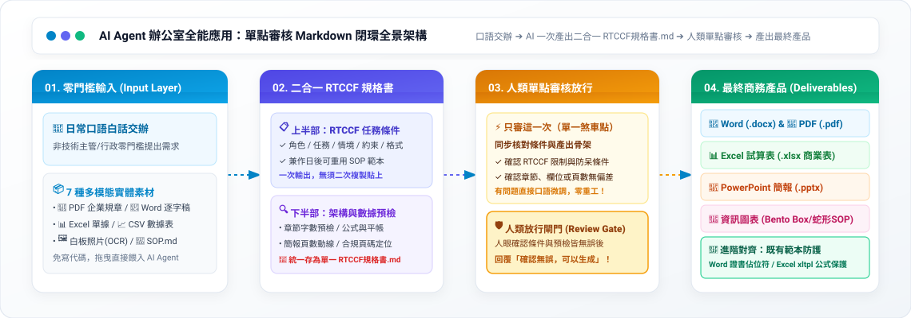

# 辦公室全能應用：五大商務交付格式生成手冊
## 🚀 AI Agent 人機協作實戰

> **本模組簡介**：本專題專為現代職場與辦公室非技術人員量身設計，徹底擺脫對單一工具的依賴。核心工作流通用於各類主流 AI Agent。
> 
> 針對初學者「不會寫 Prompt、擔心 AI 產出不可控、格式無法直接交付」的三大痛點，同時避免單一任務流程過於繁瑣，本教學全面導入 **口語條列起手 ＋ `RTCCF.md` 輕量一問一答閉環機制（Human-in-the-Loop）**，並依檔案性質設計差異化交付路徑：
> 1. **口語條列＋素材輸入**：學員用簡單的 `1. 2. 3. 4.` 日常口語條列需求（或附上 PDF、Word、Excel、CSV、白板照片等素材），要求 AI 先存為 **`RTCCF.md`** 並用「不問太細的一問一答」確認大方向，不直接吐出最終成品。
> 2. **AI 儲存 `RTCCF.md` ＋ 輕量一問一答（最多 2~3 題）**：AI 自動用專業經驗填好小細節並產出 **`RTCCF.md`**，只針對章節大綱、欄位設計或簡報每頁大綱等大方向問 2~3 題（一次 1 題並附建議選項），每確認一題就同步更新儲存 `RTCCF.md`。
> 3. **依文件類型進行 Human-in-the-Loop 交付**：
>    - **Word (`.docx`) / PDF (`.pdf`)**：確認 `RTCCF.md` 後，AI **必須先交付完整內文的 Markdown 檔案（`.md`）**，讓使用者審核 AI 寫得對不對（不對就繼續 Human-in-the-Loop 修改），確認無誤才轉換為 `.docx` 或 `.pdf`。
>    - **Excel (`.xlsx`)**：不需要多一層 `.md` 資料檔，只要 `RTCCF.md` 的任務與規格（欄位、公式、防呆）對了，就**直接交付 `.xlsx`**。
>    - **PowerPoint (`.pptx`)**：**`RTCCF.md` 內就已包含每頁大綱**，只要透過一問一答通過審核，就**直接交付 `.pptx`**。

## 🧭 AI Agent 辦公室人機協作全景架構（Human-in-the-Loop）

本手冊全面導入 **輕量一問一答 Markdown 閉環機制**，讓學生不需背誦複雜提示詞結構，就能確保 AI 產出完全受控、不跑版、符合企業實務標準：
1. **口語條列輸入 (Input Layer)**：用日常 `1. 2. 3. 4.` 條列交代任務目標，支援 PDF、Word、Excel、CSV、白板照片（OCR）等 7 大多模態實體素材。
2. **AI 儲存 `RTCCF.md` ＋ 輕量一問一答 (Spec & Q&A)**：AI 自動填妥格式與專業細節並存為 **`RTCCF.md`**（簡報類同步納入每頁大綱），只針對大方向提出 2~3 題附選項的確認問題，每答一題同步更新 `RTCCF.md`。
3. **人類確認與分流交付 (Review Gate & Deliverables Hub)**：
   - **Word / PDF**：`RTCCF.md` 通過後 ➔ **先交付完整內文 `.md` 審核修改（Human-in-the-Loop）** ➔ 定稿後轉換為 `.docx` / `.pdf`。
   - **Excel**：`RTCCF.md` 任務與規格通過後 ➔ **直接交付 `.xlsx`**。
   - **PowerPoint**：`RTCCF.md`（已含每頁大綱）通過後 ➔ **直接交付 `.pptx`**。

---

## 📌 關鍵核心原則：為什麼人機協作的任務規格書必須儲存為 `RTCCF.md`？

在與 AI Agent 進行深度人機協作時，**「將 AI 整理的任務條件與架構規格儲存為單一 Markdown 檔案 (`RTCCF.md`)」是兼顧效率與品管的最佳實踐**：

| 評估面向 | 儲存為 Markdown (`.md`) | 存為一般記事本 (`.txt`) | 存為 Word (`.docx`) |
| :--- | :--- | :--- | :--- |
| **語意結構保真度** | 🟢 **100% 原生解析**：保留 `#` 標題、`\| 表格 \|`、代碼區塊與縮排層級，AI Agent 精準理解任務角色、欄位邊界與約束條件。 | 🟡 **結構模糊**：僅有平鋪文字，複雜的交辦步驟、參數對齊容易錯位，AI Agent 容易漏看約束。 | 🔴 **格式污染**：夾帶大量二進位與 XML 富文本標籤，複製到對話介面時引發格式錯亂與雜訊。 |
| **AI Agent 相容性** | 🟢 **完美通用**：主流 AI Agent 原生皆以 Markdown 渲染與解析，直接讀取 `.md` 規格書能做到**零幻覺精準執行**。 | 🟡 段落切分較生硬，跨段落檢索容易斷層。 | 🟡 檔案體積大，上傳與解析耗時較久，部分平台解析表格易變形。 |
| **人機協作與版本控管** | 🟢 **最佳數位資產**：支援 Git、VS Code、Obsidian，一份檔案同時保存 RTCCF 提示詞與預檢標準，團隊可多人修訂並作為下次一鍵套用的 SOP 資產庫。 | 🔴 缺乏結構化，難以建立可追蹤、可擴充的規格資產庫。 | 🔴 難以進行純文字 diff 版本比較與自動化管道調用。 |

> 💡 **輕量一問一答操作原則（Human-in-the-Loop 核心前提）**：
> 1. **在步驟 1 必須要求 AI「直接儲存為 `RTCCF.md`」**：唯有產出並儲存成實體 `.md` 檔（而不只是對話框裡的文字），人類才能打開檢視、透過問答修改並真正落實 Human-in-the-Loop。
> 2. **防囉唆鐵律——小細節 AI 先填、只問 2~3 題大方向**：要求 AI 把字數分配、專業格式、公式語法等小細節先寫進 `RTCCF.md`，只針對章節架構、欄位或頁數等大方向用「一次 1 題＋建議選項」確認（最多 2~3 題），答完即定稿並可作為日後一鍵套用的 SOP 資產！

---

## 📂 核心生成格式與教學手冊

> 💡 點選下方各模組即可進入對應的實戰教學、素材與 `RTCCF.md` 一問一答範本檔案：

### 📄 01. Word (.docx) 與 PDF (.pdf) 文件生成
- **核心教學模組**：[**Word與PDF文件的生成/**](./Word與PDF文件的生成/README.md)
- **Human-in-the-Loop 交付路徑**：`RTCCF.md` 2~3 題輕量一問一答 ➔ **先交付完整內文 `.md` 審核修改** ➔ 定稿才轉換為 `.docx` / `.pdf`
- **核心實戰場景**：
  - **專案企劃書與推動計畫**：口語條列 ➔ AI 儲存 `RTCCF.md` 並以 2~3 題一問一答確認大綱 ➔ **先產出完整內文 `.md` 進行 Human-in-the-Loop 審核** ➔ 定稿轉檔 `.docx` / `.pdf`
  - **差旅規章萃取員工指南**：上傳內部 [差旅管理規範.pdf](./Word與PDF文件的生成/02_企業差旅規章萃取員工指南/素材_企業內部規章_差旅與加班管理規範.pdf) ＋ 口語條列 ➔ AI 儲存 `RTCCF.md` 並以一問一答確認條款範圍 ➔ **先產出完整指南 `.md` 核對條文與頁碼** ➔ 定稿轉檔 `.docx` / `.pdf`

### 📊 02. Excel (.xlsx) 試算表生成（前導心法＋五大階梯）
- **核心教學模組**：[**Excel試算表的生成/**](./Excel試算表的生成/README.md)
- **Human-in-the-Loop 交付路徑**：`RTCCF.md` 2~3 題輕量一問一答（確認欄位結構、公式邏輯與防呆警示）➔ **任務與規格對了直接交付 `.xlsx`**（免中間 `.md` 資料檔）
- **核心實戰場景**：
  - [**前導核心：資料架構與審核心法**](./Excel試算表的生成/00_前導核心_AI時代的Excel資料架構與審核心法/README.md)（展示層與資料層分離／四不二要心法／規格書建立）
  - **五大漸進階梯**：階梯 1 基礎建表 ➔ 階梯 2 防呆警示 ➔ 階梯 3 髒資料清洗 ➔ 階梯 4 跨表關聯 ➔ 階梯 5 商業儀表板  
    *(口語條列需求 ➔ AI 儲存 `RTCCF.md` 並透過 2~3 題輕量一問一答確認欄位與公式規格 ➔ 規格確認直接交付 `.xlsx`)*

### 📑 03. PowerPoint (.pptx) 商業簡報生成
- **核心教學模組**：[**簡報的生成/**](./簡報的生成/README.md)
- **Human-in-the-Loop 交付路徑**：`RTCCF.md`（**內含每頁大綱**）＋ 2~3 題輕量一問一答 ➔ **每頁大綱審核通過直接交付 `.pptx`**
- **核心實戰場景**：
  - **科技商務提案簡報**：口語條列 ➔ AI 儲存含 8 頁大綱的 `RTCCF.md` 並以一問一答確認 ➔ 通過後套用 [PPT 模版](./簡報的生成/01_科技商務提案簡報企劃/ptt簡報模版.pptx) **直接交付 `.pptx`**
  - **會議逐字稿萃取簡報**：上傳數千字 [會議逐字稿.docx](./簡報的生成/02_會議錄音逐字稿萃取管理簡報/素材_數位轉型專案啟動會議音訊逐字稿.docx) ＋ 口語條列 ➔ AI 儲存含 6 頁大綱的 `RTCCF.md` 並以一問一答確認 ➔ 通過後 **直接交付 `.pptx`**

### 🎨 04. 全自動資訊圖表 (Infographic) 與生圖視覺化（已獨立為專案主題）
- **獨立專題模組**：[**AI 圖像與資訊圖表生成/**](../AI圖像與資訊圖表生成/README.md)
- **子模組導航**：
  - [全自動資訊圖表的生成](../AI圖像與資訊圖表生成/全自動資訊圖表的生成/README.md)（Bento Box 便當盒排版、S-Curve 蛇形動線規格書）
  - [簡報和資訊圖表的差異](../AI圖像與資訊圖表生成/簡報和資訊圖表的差異/README.md)（演講投影片與單頁資訊地圖的本質差異與雙向轉化）

### 🎯 05. Office 應用進階的對齊（樣版防護與精準套印）
- **專題延伸模組**：[**Word (.docx) 進階對齊**](../office辦公室應用進階的對齊/docx/README.md) ｜ [**Excel (.xlsx) 進階對齊**](../office辦公室應用進階的對齊/xlsx/README.md)
- **核心特色**：解決既有精美範本跑版錯位與公式被覆蓋的殺手級應用
- **核心實戰場景**：
  - **Word 結業證明書**：既有樣版逆向提煉佔位符 ＋ 文字長度折行防跑版 `RTCCF.md` ➔ 確認審核 ➔ 批次套印
  - **Excel 商業報價單**：xltpl 動態品項 ＋ 公式防護 `RTCCF.md` ➔ 確認審核 ➔ 完整保護原生計算公式

