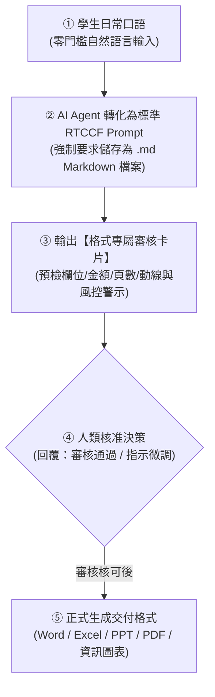
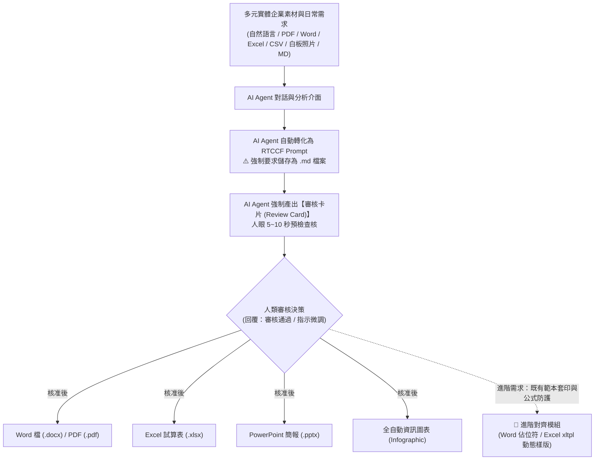

# 辦公室全能應用：五大商務交付格式生成手冊
## 🚀 AI Agent 人機協作實戰

> **本模組簡介**：本專題專為現代職場與辦公室非技術人員量身設計，徹底擺脫對單一工具的依賴。核心工作流通用於各類主流 AI Agent。
> 
> 針對初學者「不會寫 Prompt、擔心 AI 產出不可控、格式無法直接交付」的三大痛點，本教學全面導入 **人機協作（Human-in-the-Loop）四步閉環機制**：
> 1. **零門檻自然語言輸入**：學員只需輸入日常口語，AI Agent 自動轉化為專業 **RTCCF 格式**。
> 2. **強制儲存為 Markdown (.md) 檔案**：**核心守則——必須儲存為 `.md` 檔案**！Markdown 是 LLM 原生語意結構語言，唯有儲存為 `.md` 才能跨平台無損保留角色、表格、階層與約束，達到真正的人機協同與重複調用。
> 3. **強制「審核卡片（Review Card）」機制**：在產生任何實體檔案前，AI Agent 必須先產出審核卡片供人類快速核對，**待使用者確認「可以了 / 審核通過」才正式生成**。
> 4. **實體交付格式匯出**：無縫產出 **Word (.docx)**、**Excel (.xlsx)**、**PowerPoint (.pptx)**、**PDF (.pdf)** 以及 **全自動資訊圖表（Infographic）**！

---

## 📌 關鍵核心原則：為什麼人機協作對話「一定要儲存為 Markdown (.md) 檔案」？

在與 AI Agent 進行深度人機協作時，**「將 Prompt 與溝通成果儲存為 Markdown 檔案 (`.md`)」是跨平台協作不可妥協的最佳實踐**，原因如下：

| 評估面向 | 儲存為 Markdown (`.md`) | 存為一般記事本 (`.txt`) | 存為 Word (`.docx`) |
| :--- | :--- | :--- | :--- |
| **語意結構保真度** | 🟢 **100% 原生解析**：保留 `#` 標題、`| 表格 |`、代碼區塊與縮排層級，AI Agent 精準理解角色任務與邊界條件。 | 🟡 **結構模糊**：僅有平鋪文字，複雜的表格、參數對齊容易錯位，AI Agent 易漏看約束。 | 🔴 **格式污染**：夾帶大量的二進位與 XML 富文本標籤，複製到對話框時常引發格式錯亂與雜訊。 |
| **AI Agent 相容性** | 🟢 **完美通用**：AI Agent 原生皆以 Markdown 渲染，上傳或複製 `.md` 內容均能無縫解析，達到**零幻覺精準輸出**。 | 🟡 段落切分較生硬，跨段落檢索容易斷層。 | 🟡 檔案體積大，上傳與解析耗時較久，部分平台解析表格易變形。 |
| **人機協作與版本控管** | 🟢 **最佳數位資產**：支援 Git、VS Code、Obsidian、GitHub，團隊可多人協作、審核修訂與永久複用。 | 🔴 缺乏結構化，難以建立大型企業級 Prompt 資產庫。 | 🔴 難以進行純文字 diff 版本比較與自動化調用。 |

> 💡 **操作原則**：每次 AI Agent 將你的口語需求改寫為 RTCCF 格式後，**請第一時間複製並在本地或專案中新增 `.md` 檔案（例如：`採購單據清洗_Prompt.md`）儲存**。

---

## 🧭 人機協作四步標準工作流（Human-in-the-Loop）

---

## 📂 核心生成格式與教學手冊速查

| 交付格式 | 核心教學模組 | 審核卡片機制 (Review Card) | 核心實戰場景與交付成果 |
| :--- | :--- | :--- | :--- |
| 📄 **Word 檔** (`.docx`) | [**Word與PDF文件的生成/**](./Word與PDF文件的生成/README.md) | **文件架構審核卡片** （章節/字數/合規警示） | ① **專案企劃書與推動計畫**：自然語言提企劃 ➔ 轉 RTCCF 存為 `.md` ➔ 審核確認 ➔ 匯出 `.docx` ② **差旅規章萃取員工指南**：上傳 [差旅管理規範.pdf](./Word與PDF文件的生成/02_企業差旅規章萃取員工指南/素材_企業內部規章_差旅與加班管理規範.pdf) ➔ 提煉員工權益指南 |
| 📊 **Excel 檔** (`.xlsx`) | [**Excel試算表的生成/**](./Excel試算表的生成/README.md) | **數據/商業風控審核卡片** （欄位/筆數/總金額/KPI異常） | **【前導核心＋五大漸進階梯】**： • [前導核心：資料架構與審核心法](./Excel試算表的生成/00_前導核心_AI時代的Excel資料架構與審核心法/README.md)（展示層與資料層分離／四不二要／規格書） • 階梯 1 基礎建表 ➔ 階梯 2 防呆警示 ➔ 階梯 3 髒資料清洗 ➔ 階梯 4 跨表關聯 ➔ 階梯 5 商業儀表板 |
| 📑 **PowerPoint** (`.pptx`) | [**簡報的生成/**](./簡報的生成/README.md) | **簡報企劃審核卡片** （頁數/分頁核心/風格配色） | ① **科技商務提案簡報**：口語發想 ➔ 轉 RTCCF 存為 `.md` ➔ 搭配簡報模版匯出 `.pptx` ② **會議逐字稿萃取簡報**：上傳 [會議逐字稿.docx](./簡報的生成/02_會議錄音逐字稿萃取管理簡報/素材_數位轉型專案啟動會議音訊逐字稿.docx) ➔ 套用 [PPT 模版](./簡報的生成/01_科技商務提案簡報企劃/ptt簡報模版.pptx) |
| 📕 **PDF 檔** (`.pdf`) | [**Word與PDF文件的生成/**](./Word與PDF文件的生成/README.md) | **文件完整性審核卡片** （版面/章節確認） | 企劃與規章內容確認 ➔ 審核通過 ➔ 下載／列印為標準排版 `.pdf` |
| 🎨 **資訊圖表** (`Infographic`) | [**全自動資訊圖表的生成/**](./全自動資訊圖表的生成/README.md) | **視覺設計審核卡片** （動線/風格/4大模組區塊） | ① **便當盒排版法**：宣傳需求 ➔ 轉 RTCCF 存為 `.md` ➔ 產出 Bento Box 規格書與視覺代碼 ② **新人到職 SOP 流程圖**：上傳 [新人到職SOP.md](./全自動資訊圖表的生成/02_新人到職SOP指南轉蛇形流程圖解/素材_新進同仁到職七天SOP指南.md) ➔ 產出 S 型流程圖解 |
| 🎯 **進階對齊與套印** *(專題延伸)* | [**Office辦公室應用進階的對齊/**](../office辦公室應用進階的對齊/README.md) | **精準對齊與樣版防護** （公式保護/欄位不跑版） | **解決版面錯位與公式覆蓋的殺手級應用**： ① **Word 結業證明書**：既有檔案逆向提煉佔位符樣版＋文字長度自動折行批次套印 ② **Excel 商業報價單**：xltpl 動態品項列擴展＋完整保護原生計算公式 |
| 💡 **定位解析** | [**簡報和資訊圖表的差異/**](./簡報和資訊圖表的差異/README.md) | — | 深入解析口頭演講投影片與單頁視覺資訊圖表之溝通本質與設計差異（含放大鏡與導覽圖雙向互換） |

---

## 📦 專屬實體多類型偽資料庫（供課堂與自學直接下載）

為方便學員體驗真實企業辦公場景，本專案提供 **PDF、DOCX、XLSX、CSV、PNG (手寫白板)、MD 與 TXT 等 7 種實體格式**，皆可直接拖曳上傳至 AI Agent 進行多模態辨識與讀取：

👉 [**查看完整範例素材與偽資料庫總覽**](./範例素材與偽資料/README.md)

1. 📕 **PDF 規章**：[**企業內部規章_差旅與加班管理規範.pdf**](./範例素材與偽資料/企業內部規章_差旅與加班管理規範.pdf)
2. 📄 **Word 逐字稿**：[**數位轉型專案啟動會議音訊逐字稿.docx**](./範例素材與偽資料/數位轉型專案啟動會議音訊逐字稿.docx)
3. 📊 **Excel 單據**：[**各部門零碎採購申請與報價單據.xlsx**](./範例素材與偽資料/各部門零碎採購申請與報價單據.xlsx)
4. 📈 **CSV 數據表**：[**各部門採購需求原始清單.csv**](./範例素材與偽資料/各部門採購需求原始清單.csv)
5. 🖼️ **PNG 手寫白板**：[**實體白板專案討論與待辦筆記.png**](./範例素材與偽資料/實體白板專案討論與待辦筆記.png)（支援視覺多模態 OCR）
6. 📝 **Markdown 指南**：[**新進同仁到職七天SOP指南.md**](./範例素材與偽資料/新進同仁到職七天SOP指南.md)
7. 📄 **純文字備用檔**：提供對應之 `.txt` 檔案方便快速複製。

---

## 💡 AI Agent 辦公室協同工作流全景圖

