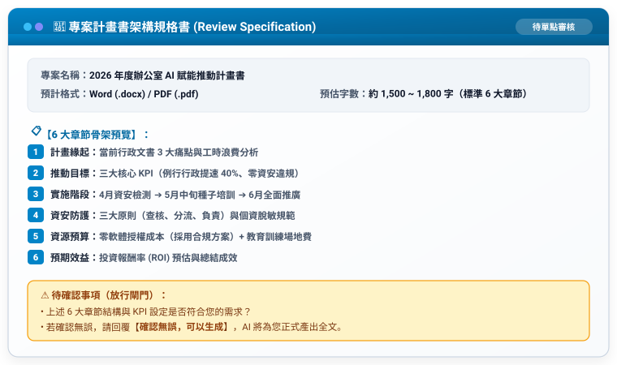

# 步驟 2：AI 一次產出之二合一 RTCCF 任務與架構規格書

> 💾 **【單點審核核心原則：一次確認，直接存為 `專案計畫書_RTCCF規格書.md`】**  
> *（AI 必須將「上半部 RTCCF 條件」＋「下半部架構預檢卡片」直接儲存為單一 `.md` 實體檔案交付審核，唯有存成 `.md` 檔才能落實 Human-in-the-Loop 單點把關與修改；日後若要重複撰寫同類企劃，也可直接複製本 `.md` 範本一鍵套用！）*

## 📋 上半部：RTCCF 任務規格定義

```markdown
## Role
你是一位資深企業營運規劃師，擅長撰寫結構嚴謹、條理分明的正式公務企劃書。

## Task
請幫我撰寫一份完整的「2026 年度辦公室 AI 賦能推動計畫書」，準備提交給高階主管核閱。

## Context
- 核心目標：引進生成式 AI 辦公室工具（Claude / ChatGPT / Gemini / Antigravity），協助非技術同仁處理公文、試算表、簡報與資訊圖表，節省 40% 行政工時。
- 推動對象：全體非技術同仁（約 80 人）。

## Constraint
- 必須包含：計畫緣起、KPI目標、分階段時程、資安與去識別化規範、預算配置、預期成效。
- 語言：繁體中文，公務正式口吻，字數約 1,500 字。
- 執行限制：先將本規格書與【6 大章節骨架預檢卡片】二合一儲存為 `專案計畫書_RTCCF規格書.md` 檔案交付審核，待我單次確認後再輸出全文。

## Format
- 階層標題（Markdown #、##、###）、標準三欄表格。
```

## 🛡️ 下半部：計畫架構預檢卡片（單點審核閘門）



---

[← 返回步驟 1](./1-1_白話自然語言發想提示詞.md) ｜ [前往步驟 3：單點審核放行與生成 →](./1-3_審核卡片覆核與正式生成提示詞.md)
