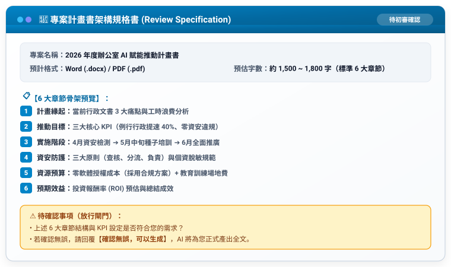

# 步驟 3：審核卡片覆核與正式生成提示詞

## 🛡️ 人機協商閘門：AI 輸出的「專案計畫書審核卡片」

在產出正式長文之前，AI 必須先輸出此卡片供人類核准：



---

## 💬 人類核准指令（發送給 AI）

學員檢查審核卡片後，直接回覆：

```text
確認無誤，可以生成。
```

---

## 📥 匯出 Word (.docx) 與 PDF (.pdf)

- **Gemini**：右下角「**分享與匯出**」➔「**匯出至 Google 文件**」➔ 檔案 ➔ 下載為 `.docx` 或 `.pdf`。
- **Claude.ai**：Artifacts 富文本複製貼入 Word，或另存為 PDF。
- **ChatGPT**：Canvas 畫布檢視 ➔ 點選下載或以列印另存為 PDF。
- **Google Antigravity**：指示 Agent 直接編譯儲存為 `.docx` / `.pdf`。

產出的完整示範成果請參閱：[**`2026年度辦公室AI賦能推動計畫書_範本.md`**](./2026年度辦公室AI賦能推動計畫書_範本.md)。

---

[← 返回步驟 2](./1-2_AI產出之RTCCF專案計畫書提示詞.md) ｜ [返回範例導覽](./README.md)
