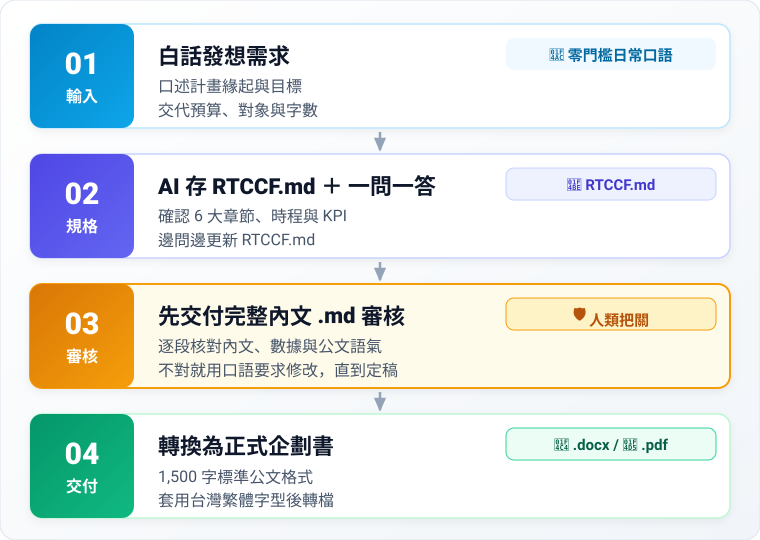

📍 [常見的 AI 應用](../../../README.md) › [辦公室全能應用](../../README.md) › [Word 與 PDF](../README.md) › **範例 01：專案企劃書**

# 實戰範例 01：專案企劃書與推動計畫（Word / PDF）

## 📥 學員實戰素材與交付成品

- **核心交付成品**：
  - [**`2026年度辦公室AI賦能推動計畫書_範本.md`**](./2026年度辦公室AI賦能推動計畫書_範本.md) *(由 AI 完整產出之 1,500 字標準公文格式企劃書，可一鍵轉為 Word (.docx) 或 PDF (.pdf))*

---

## 🏆 案例情境與業務痛點

企業非技術同仁在撰寫專案企劃書時，常面臨三大困擾：
1. **指令空泛，AI 產出不知所云**：直接告訴 AI「幫我寫企劃」，產出往往缺少推動對象、分階段時程與資安規範。
2. **缺乏審查機制，直接長篇大論**：AI 一口氣產生數千字，若方向偏差必須整篇重寫，浪費時間。
3. **沒有保存可重用規格資產**：缺少結構化的 `RTCCF.md` 範本，下次做類似企劃又得從頭描述需求。

---

## ⚡ 人機協商工作流程（Human-in-the-Loop）



---

## 🛠️ 實戰演練：口語條列 ➔ AI 儲存 `RTCCF.md` ＋ 一問一答（5~6 題）➔ `.md` 審核 ➔ 實體文件

> 💡 對照[共通工作流](../../00_共通工作流/README.md)的 **6 個口語重點**，用自己平時講話的方式簡短條列即可，不用複製貼上。

### 步驟 1：依 6 個重點，用自己的口語條列輸入

學員不需複製或背誦提示詞，只需對照 6 個重點，用自己平時講話的方式簡短條列輸入對話框即可（以下為口語示範，每一列都簡短好懂）：

```text
1. 我想寫一份給主管看的專案計畫書，主題是「推動非技術同仁使用 AI 辦公室工具」。
2. 裡面要有緣由、目標、步驟、資安跟預算，大概 1500 字，語氣要正式。
3. 先不要直接寫完整長文，先幫我整理成 RTCCF 規格書並存成 RTCCF.md。
4. 小細節你直接用專業幫我填好，大方向我們用「一問一答」確認就好。
5. 一次問我 1 題並給建議選項，不要問太細，最多問 5~6 題。
6. 每確認完一題，就幫我更新儲存一次 RTCCF.md。
```

---

### 步驟 2：與 AI 進行 5~6 題一問一答（用口語回覆收斂 `RTCCF.md`）

因為每個人與 AI 對話的脈絡不同，後續問題由現場互動決定，學員只需把握兩個重點：
1. **AI 自動建立首版 `RTCCF.md`**：送出後 AI 會先填好字數配置、公文口吻等細節，並存成 `RTCCF.md`。
2. **依重點用口語回答 5~6 題**：AI 會一次問 1 題並給選項（例如確認章節大綱、推動時程或 KPI），你只要用口語選選項或簡短補充，AI 就會同步更新儲存 `RTCCF.md`。

---

### 步驟 3：確認 `RTCCF.md` 定案 ➔ 先交付完整內文 `.md`（Human-in-the-Loop 審核）

**🛡️ 先打開定稿 `RTCCF.md` 檢查兩點**：
1. **RTCCF 任務條件**：推動對象（80 人）、字數（1,500 字）與必含項目正確。
2. **章節架構大方向**：6 大章節骨架、KPI 與推動時程符合主管期待。

兩點都沒問題後，**先要求 AI 交付完整內文的 Markdown 檔案**，確認 AI 寫得對不對（此時還不轉 Word/PDF）：

```text
RTCCF.md 規格確認無誤，請先依規格產出完整內文並儲存為 Markdown 檔案讓我審核！
```

- 📄 **示範產出參考**：**`2026年度辦公室AI賦能推動計畫書_範本.md`**
- 🔍 **審核重點**：檢查 AI 產出的 `.md` 內文架構、數據與公文語氣是否符合期待；若有不精準之處，直接在對話中要求修正 `.md` 檔直到確認無誤。

---

### 步驟 4：Markdown 內文審核完成 ➔ 轉換為 Word (.docx) 與 PDF (.pdf)

`.md` 內文審核通過後才轉檔。請到 [**Word 與 PDF 模組的「轉檔 Prompt」**](../README.md) 複製 **① Word＋PDF 萬用 Prompt** 貼給 AI，即可同時鎖定台灣繁體字型；同一處也有各 AI 平台的匯出方式。

---

🧭 [⬆ 回到：Word 與 PDF](../README.md) ｜ [下一頁：範例 02：差旅規章員工指南 ➡](../02_企業差旅規章萃取員工指南/README.md)
