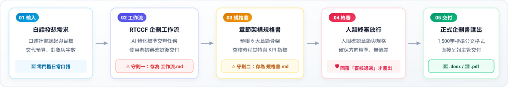

# 實戰範例 01：專案企劃書與推動計畫（Word / PDF）

> 🟢 **適用範圍**：通用於各主流 AI Agent（Web 對話介面與 Coding Agent）  
> 🛠️ **核心工作流**：**雙階段 Markdown 審核閉環**（口語發想 ➔ 存為 `工作流.md` 初審 ➔ 產出 `規格書.md` 終審 ➔ 正式生成 Word/PDF）

---

## 📥 學員實戰素材與交付成品

- **核心交付成品**：
  - [**`2026年度辦公室AI賦能推動計畫書_範本.md`**](./2026年度辦公室AI賦能推動計畫書_範本.md) *(由 AI 完整產出之 1,500 字標準公文格式企劃書，可一鍵轉為 Word (.docx) 或 PDF (.pdf))*

---

## 🏆 案例情境與業務痛點

企業非技術同仁在撰寫專案企劃書時，常面臨三大困擾：
1. **指令空泛，AI 產出不知所云**：直接告訴 AI「幫我寫企劃」，產出往往缺少推動對象、分階段時程與資安規範。
2. **缺乏審查機制，直接長篇大論**：AI 一口氣產生數千字，若方向偏差必須整篇重寫，浪費時間。
3. **沒有保存結構化工作流**：沒有將 RTCCF 任務儲存為 `工作流.md` 檔案，缺乏版本管理與可重複調用的交辦資產。

---

## ⚡ 人機協商工作流程（Human-in-the-Loop）



---

## 🛠️ 實戰演練：自然語言 ➔ RTCCF 交辦事項 ➔ 規格書 ➔ 實體文件

學員不必在多個檔案間切換，以下完整展示從白話日常口語到生成最終企劃書的完整流程：

### 步驟 1：日常自然語言輸入（零門檻口述需求）

學員完全不需要先學會寫複雜的提示詞，只要在 AI Agent 對話框中輸入日常白話：

```text
我想寫一份公司今年推動非技術同仁使用 AI 辦公室工具的專案計畫書給主管看，希望大概包含計畫緣由、目標、推動步驟、資安跟預算，字數大概 1500 字，口吻要專業正式。
請先幫我把這段需求改寫成標準的 RTCCF 交辦事項（工作流），讓我儲存為 Markdown (.md) 檔案；並且先產出「計畫審核規格書」給我看，不要直接輸出完整長文。待我確認 Markdown 內容與架構後，請再依照該 Markdown 檔為我正式生成完整文件。
```

---

### 步驟 2：AI Agent 轉化為 RTCCF 交辦事項（⚠️ 強制儲存為 `工作流.md`）

AI Agent 接收口語後，自動結構化出標準交辦事項。**請學員第一時間將此內容儲存為 `專案計畫書_工作流.md` 檔案**（唯有 `.md` 才能跨平台完整保留語意與約束，作為企業可沉澱的交辦資產）：

```markdown
## Role
你是一位資深企業營運規劃師，擅長撰寫結構嚴謹、條理分明的正式公務企劃書。

## Task
請幫我撰寫一份完整的「2026 年度辦公室 AI 賦能推動計畫書」，準備提交給高階主管核閱。

## Context
- 核心目標：引進主流 AI Agent 辦公室工具，協助非技術同仁處理公文、試算表、簡報與資訊圖表，節省 40% 行政工時。
- 推動對象：全體非技術同仁（約 80 人）。

## Constraint
- 必須包含：計畫緣起、KPI 目標、分階段時程、資安與去識別化規範、預算配置、預期成效。
- 語言：繁體中文，公務正式口吻。
- 執行限制：【第一步必須先產出審核規格書】，待我確認後再輸出全文。

## Format
- 階層標題（Markdown #、##、###）、標準三欄表格。
```

> 👤 **人類初審**：使用者在本地或專案中檢視 `工作流.md`，可隨時微調推動對象或時程，確認無誤後將此交辦事項傳送給 AI Agent 執行。

---

### 步驟 3：傳遞工作流 ➔ AI Agent 輸出「企劃架構規格書」（⚠️ 亦存為 `規格書.md`）

AI Agent 接獲交辦事項後，不會貿然產出數千字長文，而是先輸出規格書供人類查核：


---

### 步驟 4：人類終審放行 ➔ 正式生成 Word (.docx) 與 PDF (.pdf)

使用者人眼核對 6 大章節架構完全符合預期後，發送放行指令：

```text
確認無誤，可以生成。
```

AI Agent 立即依循規格書輸出完整 1,500 字企劃長文：
- 📄 **完整示範成果**：請直接點閱參閱 [**`2026年度辦公室AI賦能推動計畫書_範本.md`**](./2026年度辦公室AI賦能推動計畫書_範本.md)。
- 📥 **匯出方式**：可直接在 AI Agent 對話介面匯出至線上文件另存為 Word/PDF，或由 Coding Agent 自動化編譯輸出為標準實體 `.docx` 或 `.pdf` 檔案交付主管！

---

[← 返回 Word與PDF文件生成模組](../README.md)

