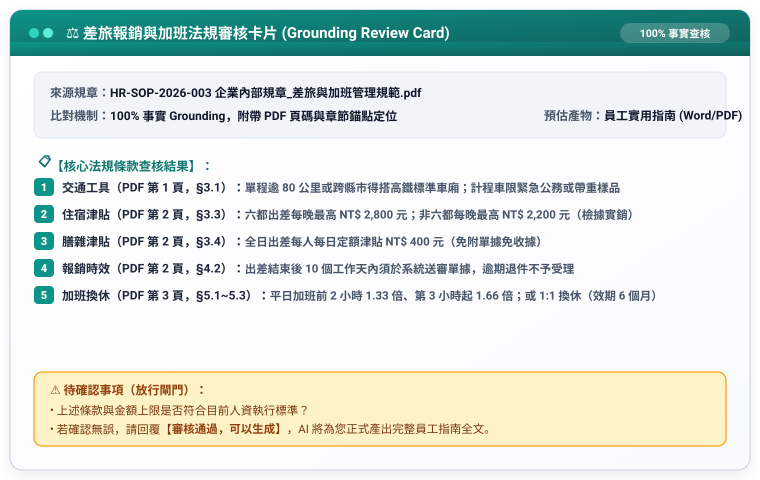

# 步驟 2：AI 儲存 `RTCCF.md` 規格書 ＋ 輕量一問一答確認大方向

> 💾 **【Human-in-the-Loop 核心原則：AI 存為 `RTCCF.md` ＋ 最多 2~3 題大方向確認】**  
> *（AI 會自動依 PDF 補齊防幻覺限制與語氣設定，直接儲存為單一 `RTCCF.md` 實體檔案；並只針對章節結構與萃取津貼標準用「一次 1 題＋建議選項」跟學員確認，每答一題同步更新儲存 `RTCCF.md`。日後若規章更新要重新編修，也可直接複製這份 `RTCCF.md` 一鍵套用！）*

## 📋 AI 產出並儲存之 `RTCCF.md` 萃取規格

```markdown
## Role
資深企業人資勞動法規顧問。

## Task
以已上傳之《企業內部規章_差旅與加班管理規範.pdf》為唯一客觀事實來源，為全體同仁編寫一份白話、易查、零歧義的「員工差旅報銷與加班權益指南」公務手冊草案。

## Context
來源為星雲數位科技股份有限公司內部規章（文件編號 HR-SOP-2026-003），避免同仁因規章繁雜造成報銷錯誤或逾期退件。

## Constraint
1. 嚴格依據上傳之 PDF 內容萃取，嚴禁臆測外部法規。
2. 每一項金額上限、天數規範、申請權限必須附帶上傳 PDF 頁碼與章節以供查核。
3. 執行限制：小細節依 PDF 與專業慣例自動補齊，僅針對指南章節架構與關鍵津貼標準透過「一問一答（一次 1 題、附選項、最多 2~3 題）」確認，確認後同步更新本 `RTCCF.md` 再展開完整指南。
4. 語言：繁體中文，親切易懂但不失商務嚴謹。

## Format
階層標題（Markdown #、##、###）、常見問答 FAQ、重要警示 Callout。
```

## 🛡️ 一問一答確認大方向：法規條款預檢總覽

AI 在一問一答中會將以下萃取重點與 PDF 頁碼對照提供給學員確認（最多 2~3 題，不問太細）：



---

[← 返回步驟 1](./2-1_白話自然語言發想提示詞.md) ｜ [前往步驟 3：確認 `RTCCF.md` 放行與生成 →](./2-3_差旅審核卡片與員工指南生成提示詞.md)
