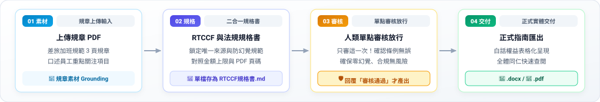

📍 [常見的 AI 應用](../../../README.md) › [辦公室全能應用](../../README.md) › [Word 與 PDF](../README.md) › **範例 02：差旅規章員工指南**

# 實戰範例 02：企業差旅規章萃取員工指南（Word / PDF）

## 📥 學員實戰素材與交付成品

- **必載輸入素材**：
  - [**`素材_企業內部規章_差旅與加班管理規範.pdf`**](./素材_企業內部規章_差旅與加班管理規範.pdf) *(3 頁正式公司規章，亦可使用 [純文字檔](./素材_企業內部規章_差旅與加班管理規範.txt))*
- **核心交付成品**：
  - [**`員工差旅報銷與加班權益指南_範本.md`**](./員工差旅報銷與加班權益指南_範本.md) *(由 AI 依據素材精準萃取之白話版員工權益指南，可一鍵轉為 Word (.docx) 或 PDF (.pdf))*

---

## 🏆 案例情境與業務痛點

許多公司的人資規章長達數十頁、文字艱澀，同仁出差報銷或加班時經常：
1. **找不到關鍵規定**：搞不清楚高鐵搭乘資格、住宿上限是多少、出差幾天內要報銷。
2. **詢問人資造成負擔**：重複問題天天問，耗費人資大量答覆時間。
3. **AI 隨意回答產生幻覺**：若沒有上傳真實規章 PDF，AI 會自行瞎掰外部法規，造成內部違規風險。

---

## ⚡ 人機協商工作流程（Human-in-the-Loop）



---

## 🛠️ 實戰演練：口語條列 ➔ AI 儲存 `RTCCF.md` ＋ 一問一答（5~6 題）➔ `.md` 核對 ➔ 實體文件

> 💡 對照[共通工作流](../../00_共通工作流/README.md)的 **6 個口語重點**，用自己平時講話的方式簡短條列即可，不用複製貼上。

### 步驟 1：依 6 個重點，上傳 PDF 並用自己的口語條列輸入

在 Claude、ChatGPT、Gemini 上傳 `素材_企業內部規章_差旅與加班管理規範.pdf`（Antigravity 則指定路徑），接著對照 6 個重點，用自己的口語簡短條列（以下為口語示範，每一列都簡短好懂）：

```text
1. 請根據我上傳的差旅規範 PDF，寫一份給全體員工看的「出差報銷與加班權益指南」。
2. 重點要寫清楚交通、住宿、膳雜費、報銷時限跟加班換休，要照 PDF 寫不能亂編。
3. 先不要直接寫完整指南，先幫我整理成 RTCCF 規格書並存成 RTCCF.md。
4. 小細節（像標註頁碼與排版）你先填好，大方向我們用「一問一答」確認就好。
5. 一次問我 1 題並給建議選項，不要問太細，最多問 5~6 題。
6. 每確認完一題，就幫我更新儲存一次 RTCCF.md。
```

---

### 步驟 2：與 AI 進行 5~6 題一問一答（用口語回覆收斂 `RTCCF.md`）

因為每份規章重點與現場需求不同，後續問題由現場互動決定，學員只需把握兩個重點：
1. **AI 自動建立首版 `RTCCF.md`**：送出後 AI 會依 PDF 補齊「嚴禁臆測外部法規、標註頁碼」等細節，並存成 `RTCCF.md`。
2. **依重點用口語回答 5~6 題**：AI 會一次問 1 題並給選項（例如確認指南章節架構與津貼標準），你只要用口語選選項或簡短補充，AI 就會同步更新儲存 `RTCCF.md`。

---

### 步驟 3：確認 `RTCCF.md` 定案 ➔ 先交付完整內文 `.md`（Human-in-the-Loop 核對條款）

**🛡️ 先打開定稿 `RTCCF.md` 檢查兩點**：
1. **RTCCF 防幻覺條件**：確認嚴格限定「僅依上傳之 PDF 規章萃取」。
2. **法規條款大方向**：確認交通、住宿、膳雜、報銷時效與加班換休之萃取範圍無誤。

兩點都沒問題後，**先要求 AI 交付完整員工指南的 Markdown 檔案**，用來核對 AI 萃取的規章金額與頁碼對不對：

```text
RTCCF.md 規格確認無誤，請先依規格產出完整員工指南並儲存為 Markdown 檔案讓我審核！
```

- 📄 **示範產出參考**：**`員工差旅報銷與加班權益指南_範本.md`**
- 🔍 **審核重點**：打開 `.md` 檔逐項比對車資上限、住宿費、報銷時效與 PDF 頁碼；若有疏漏或幻覺，直接透過對話請 AI 修改 `.md` 檔直到確認無誤。

---

### 步驟 4：Markdown 內文審核完成 ➔ 轉換為 Word (.docx) 與 PDF (.pdf)

`.md` 內文審核通過後才轉檔。請到 [**Word 與 PDF 模組的「轉檔 Prompt」**](../README.md) 複製 **① Word＋PDF 萬用 Prompt** 貼給 AI，即可同時鎖定台灣繁體字型；同一處也有各 AI 平台的匯出方式。

---

🧭 [⬅ 上一頁：範例 01：專案企劃書](../01_專案企劃書與推動計畫/README.md) ｜ [⬆ 回到：Word 與 PDF](../README.md) ｜ [下一頁：前導核心：資料架構與審核心法 ➡](../../Excel試算表的生成/00_前導核心_AI時代的Excel資料架構與審核心法/README.md)
