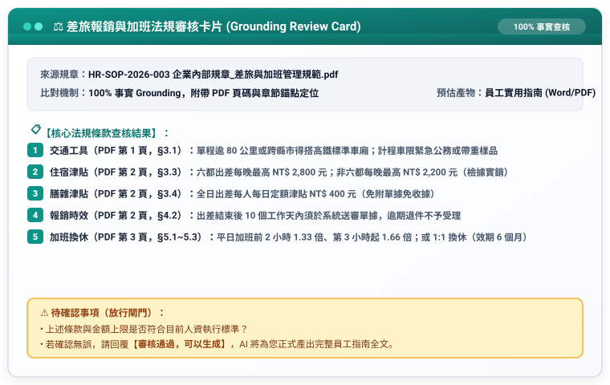

# 實戰範例 02：企業差旅規章萃取員工指南（Word / PDF）

> 🟢 **適用範圍**：通用於各主流 AI Agent（Web 對話介面與 Coding Agent）  
> 🛠️ **核心工作流**：**口語條列起手 ＋ `RTCCF.md` 輕量一問一答閉環**（上傳規章 PDF ＋ 口語條列 ➔ AI 存為 `RTCCF.md` 並用 2~3 題問答確認條款 ➔ 正式生成 Word/PDF）

---

## 📥 學員實戰素材與交付成品

- **必載輸入素材**：
  - [**`素材_企業內部規章_差旅與加班管理規範.pdf`**](./素材_企業內部規章_差旅與加班管理規範.pdf) *(3 頁正式公司規章，亦可使用 [純文字檔](./素材_企業內部規章_差旅與加班管理規範.txt))*
- **核心交付成品**：
  - [**`員工差旅報銷與加班權益指南_範本.md`**](./員工差旅報銷與加班權益指南_範本.md) *(由 AI 依據素材精準萃取之白話版員工權益指南，可一鍵轉為 Word (.docx) 或 PDF (.pdf))*

---

## 🏆 案例情境與業務痛點

許多公司的人資規章長達數十頁、文字艱澀，同仁出差報銷或加班時經常：
1. **找不到關鍵規定**：搞不清楚高鐵搭乘資格、住宿上限是多少、出差幾天內要報銷。
2. **詢問人資造成負擔**：重複問題天天問，耗費人資大量答覆時間。
3. **AI 隨意回答產生幻覺**：若沒有上傳真實規章 PDF，AI 會自行瞎掰外部法規，造成內部違規風險。

---

## ⚡ 人機協商工作流程（Human-in-the-Loop）


---

## 🛠️ 實戰演練：口語條列 ➔ AI 儲存 `RTCCF.md` ＋ 輕量一問一答 ➔ 實體文件

學員不需要背誦複雜提示詞，只要上傳 PDF 並用日常口語條列需求，交由 AI 整理細節並透過 2~3 題「一問一答」確認大方向：

### 步驟 1：日常口語條列輸入（零門檻起手）

在 Claude、ChatGPT、Gemini 點選「**＋ 上傳檔案**」上傳 [`素材_企業內部規章_差旅與加班管理規範.pdf`](./素材_企業內部規章_差旅與加班管理規範.pdf)（Antigravity 則直接指定檔案路徑），並輸入日常條列式需求：

```text
1. 請根據我上傳的差旅規範 PDF，幫我寫一份給全體員工看的「出差報銷與加班權益指南」Word 檔草案。
2. 裡面要把大家最常問的交通、住宿、膳雜費上限、幾天內要報銷、還有加班換休規定寫清楚，並且一定要照 PDF 內容寫、不能自己亂編。
3. 先不要直接寫出整篇指南！請先幫我整理成 RTCCF 規格書，並直接儲存為 Markdown 檔案（RTCCF.md）。
4. 小細節請你直接依 PDF 幫我規劃好，只要針對大方向（例如指南章節結構與萃取出的津貼標準）用「一問一答」跟我確認（一次問 1 題並給建議選項，不要問太細，最多問 2~3 題就好），每確認一題就幫我更新儲存 RTCCF.md！
```

---

### 步驟 2：AI 儲存 `RTCCF.md` ＋ 輕量一問一答（只問 2~3 題大方向）

AI Agent 接收口語與附件後，會自動依 PDF 補齊防幻覺規範並直接儲存 **`RTCCF.md`** 交付審核，並拋出 2~3 題附帶選項的大方向問題（例如確認章節結構與各項津貼對照表），每回答一題即同步更新儲存 `RTCCF.md`：

**【AI 產出並儲存的 `RTCCF.md` 範例】**

```markdown
## Role
資深企業人資勞動法規顧問。

## Task
以已上傳之《企業內部規章_差旅與加班管理規範.pdf》為唯一客觀事實來源，為全體同仁編寫一份白話、易查、零歧義的「員工差旅報銷與加班權益指南」公務手冊草案。

## Context
來源為星雲數位科技股份有限公司內部規章（文件編號 HR-SOP-2026-003），避免同仁因規章繁雜造成報銷錯誤或逾期退件。

## Constraint
1. 嚴格依據上傳之 PDF 內容萃取，嚴禁臆測外部法規。
2. 每一項金額上限、天數規範、申請權限必須附帶上傳 PDF 頁碼與章節以供查核。
3. 執行限制：小細節依 PDF 與專業慣例自動補齊，僅針對指南章節架構與關鍵津貼標準透過「一問一答（一次 1 題、附選項、最多 2~3 題）」確認，確認後同步更新本 `RTCCF.md` 再產出全文。
4. 語言：繁體中文，親切易懂但不失商務嚴謹。

## Format
階層標題（Markdown #、##、###）、常見問答 FAQ、重要警示 Callout。
```

**【AI 透過一問一答確認的大方向預檢總覽】**



> 👤 **輕量 Human-in-the-Loop（不問太細）**：AI 主動附上建議選項，學員只要花 30 秒回答 2~3 題確認交通、住宿、膳雜、加班金額上限與 PDF 頁碼對應無誤，AI 即同步更新儲存 **`RTCCF.md`**；日後規章改版時也能一鍵重用！

---

### 步驟 3：人類確認放行 ➔ 正式生成 Word (.docx) 與 PDF (.pdf)

一問一答完成且打開確認定稿後的 `RTCCF.md` 無誤，直接發送放行指令：

```text
RTCCF.md 規格確認無誤，請正式生成完整員工指南！
```

AI Agent 立即依循規格書輸出完整指南全文：
- 📄 **完整示範成果**：請直接點閱參閱 [**`員工差旅報銷與加班權益指南_範本.md`**](./員工差旅報銷與加班權益指南_範本.md)。
- 📥 **匯出方式**：可直接在 AI Agent 對話介面匯出至線上文件另存為 Word/PDF，或由 Coding Agent 自動化編譯輸出為標準實體 `.docx` 或 `.pdf` 檔案交付同仁！

---

[← 返回 Word與PDF文件生成模組](../README.md)

