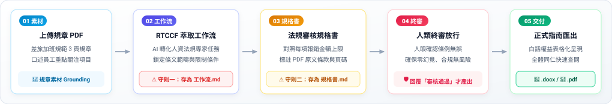
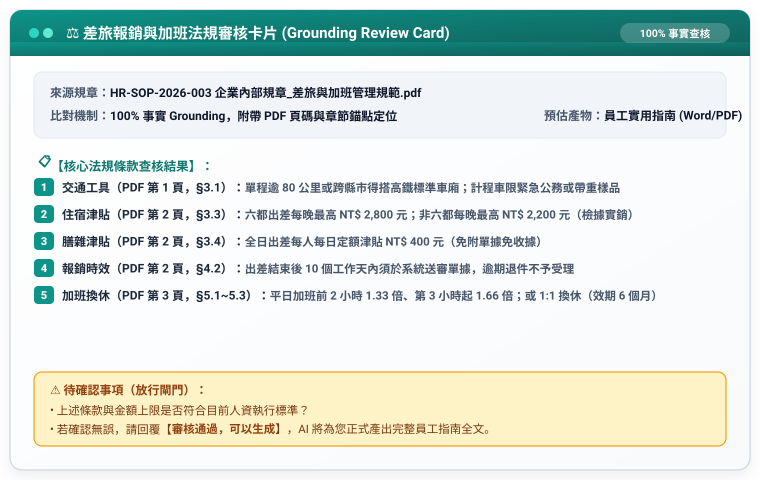

# 實戰範例 02：企業差旅規章萃取員工指南（Word / PDF）

> 🟢 **適用範圍**：通用於各主流 AI Agent（Web 對話介面與 Coding Agent）  
> 🛠️ **核心工作流**：**雙階段 Markdown 審核閉環**（上傳規章 PDF ➔ 存為 `工作流.md` 初審 ➔ 產出 `規格書.md` 終審 ➔ 正式生成 Word/PDF）

---

## 📥 學員實戰素材與交付成品

- **必載輸入素材**：
  - [**`素材_企業內部規章_差旅與加班管理規範.pdf`**](./素材_企業內部規章_差旅與加班管理規範.pdf) *(3 頁正式公司規章，亦可使用 [純文字檔](./素材_企業內部規章_差旅與加班管理規範.txt))*
- **核心交付成品**：
  - [**`員工差旅報銷與加班權益指南_範本.md`**](./員工差旅報銷與加班權益指南_範本.md) *(由 AI 依據素材精準萃取之白話版員工權益指南，可一鍵轉為 Word (.docx) 或 PDF (.pdf))*

---

## 🏆 案例情境與業務痛點

許多公司的人資規章長達數十頁、文字艱澀，同仁出差報銷或加班時經常：
1. **找不到關鍵規定**：搞不清楚高鐵搭乘資格、住宿上限是多少、出差幾天內要報銷。
2. **詢問人資造成負擔**：重複問題天天問，耗費人資大量答覆時間。
3. **AI 隨意回答產生幻覺**：若沒有上傳真實規章 PDF，AI 會自行瞎掰外部法規，造成內部違規風險。

---

## ⚡ 人機協商工作流程（Human-in-the-Loop）




---

## 🛠️ 實戰演練：自然語言 ➔ RTCCF 交辦事項 ➔ 規格書 ➔ 實體文件

學員不必在多個檔案間切換，以下完整展示從白話日常口語到生成最終員工指南的完整流程：

### 步驟 1：日常自然語言輸入（零門檻口述需求）

在 Claude、ChatGPT、Gemini 點選「**＋ 上傳檔案**」上傳 [`素材_企業內部規章_差旅與加班管理規範.pdf`](./素材_企業內部規章_差旅與加班管理規範.pdf)（Antigravity 則直接指定檔案路徑），並輸入日常白話：

```text
請根據我剛才上傳的差旅規範 PDF，幫我寫一份給全體員工看的「出差報銷與加班權益指南」Word 檔草案。
請先幫我把這段需求改寫成標準的 RTCCF 交辦事項（工作流），讓我儲存為 Markdown (.md) 檔案；並且先產出「審核卡片」讓我看有哪些條文重點，不要直接輸出完整長文。待我確認 Markdown 內容與架構後，請再依照該 Markdown 檔為我正式生成完整文件。
```

---

### 步驟 2：AI Agent 轉化為 RTCCF 交辦事項（⚠️ 強制儲存為 `工作流.md`）

AI Agent 接收口語與附件後，自動結構化出標準交辦事項。**請學員第一時間將此內容儲存為 `差旅規章萃取_工作流.md` 檔案**：

```markdown
## Role
資深企業人資勞動法規顧問。

## Task
以已上傳之《企業內部規章_差旅與加班管理規範.pdf》為唯一客觀事實來源，為全體同仁編寫一份白話、易查、零歧義的「員工差旅報銷與加班權益指南」公務手冊草案。

## Context
來源為星雲數位科技股份有限公司內部規章（文件編號 HR-SOP-2026-003），避免同仁因規章繁雜造成報銷錯誤或逾期退件。

## Constraint
1. 嚴格依據上傳之 PDF 內容萃取，嚴禁臆測外部法規。
2. 每一項金額上限、天數規範、申請權限必須於審核卡片中附帶上傳 PDF 頁碼與章節。
3. 執行限制：【第一步必須先產出審核規格書】，待我確認後再輸出全文。
4. 語言：繁體中文，親切易懂但不失商務嚴謹。

## Format
階層標題（Markdown #、##、###）、常見問答 FAQ、重要警示 Callout。
```

> 👤 **人類初審**：使用者在本地或專案中檢視 `工作流.md`，可隨時核對引用規章或約束條件，確認無誤後將此交辦事項傳送給 AI Agent 執行。

---

### 步驟 3：傳遞工作流 ➔ AI Agent 輸出「差旅法規審核規格書」（⚠️ 亦存為 `規格書.md`）

AI Agent 接獲交辦事項後，不會貿然產出數千字長文，而是先輸出規格書供人類查核（附帶 100% PDF 頁碼定位）：



---

### 步驟 4：人類終審放行 ➔ 正式生成 Word (.docx) 與 PDF (.pdf)

使用者人眼核對各項交通、住宿、膳雜與加班條款完全符合規章後，發送放行指令：

```text
審核通過，可以生成。
```

AI Agent 立即依循規格書輸出完整指南全文：
- 📄 **完整示範成果**：請直接點閱參閱 [**`員工差旅報銷與加班權益指南_範本.md`**](./員工差旅報銷與加班權益指南_範本.md)。
- 📥 **匯出方式**：可直接在 AI Agent 對話介面匯出至線上文件另存為 Word/PDF，或由 Coding Agent 自動化編譯輸出為標準實體 `.docx` 或 `.pdf` 檔案交付同仁！

---

[← 返回 Word與PDF文件生成模組](../README.md)

