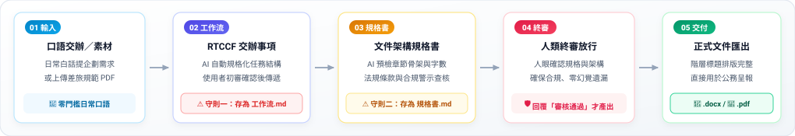

# Word (.docx) 與 PDF (.pdf) 文件生成模組
## 🚀 AI Agent 公文、企劃與報告實戰

> ### 🎯 模組核心目標
> 
> 非技術同仁常面臨公文排版、專案企劃書與法規指引撰寫的繁瑣流程。本模組全面導入 **雙階段 Markdown 審核閉環機制**：
> 
> 1. **零門檻日常口語交辦**：白話口述需求或直接上傳內部規章 PDF。
> 2. **AI 規格化工作流**：AI 自動生成 RTCCF 任務結構（**強制存為 `工作流.md`**，人類初審確認後傳遞）。
> 3. **文件架構規格書**：AI 預檢章節骨架、字數規劃與合規防線（**強制存為 `規格書.md`**，作為終審驗收基準）。
> 4. **正式生成實體文件**：人類確認「審核通過」放行後，AI Agent 正式匯出 **Word (.docx)** 與 **PDF (.pdf)**！

---

## 🧭 人機協作標準工作流（Human-in-the-Loop）

---

## 📚 次資料夾實戰範例導覽

本模組收錄兩大核心商業實戰範例，提供完整交辦工作流、審核規格書與產出範本：

### 📄 01. 專案企劃書與推動計畫
- **範例連結**：[**01_專案企劃書與推動計畫/**](./01_專案企劃書與推動計畫/README.md)
- **實戰情境**：**口語直接發想**（零門檻日常白話）
- **業務場景**：口語交代重點，由 AI 規劃 1,500 字「2026 年度辦公室 AI 賦能推動計畫書」
- **雙階段交付成果**：
  - 企劃工作流 ➔ 章節架構規格書 ➔ 產出 [`2026年度辦公室AI賦能推動計畫書_範本.md`](./01_專案企劃書與推動計畫/2026年度辦公室AI賦能推動計畫書_範本.md) ➔ 匯出 `.docx` / `.pdf`

### 📘 02. 企業差旅規章萃取員工指南
- **範例連結**：[**02_企業差旅規章萃取員工指南/**](./02_企業差旅規章萃取員工指南/README.md)
- **實戰情境**：**企業規章萃取**（上傳內部規章 PDF）
- **業務場景**：上傳內部 3 頁差旅管理辦法 PDF，零幻覺提煉差旅報銷標準與加班換休權益指南
- **雙階段交付成果**：
  - 規章萃取工作流 ➔ 合規審核規格書 ➔ 產出 [`員工差旅報銷與加班權益指南_範本.md`](./02_企業差旅規章萃取員工指南/員工差旅報銷與加班權益指南_範本.md) ➔ 匯出 `.docx` / `.pdf`

> 💡 **進階延伸**：若手邊已有一份正式排版之 `.docx` 文件（如結業證書、聘書、公函），需要保護其既有格式、防止字數過長跑版並進行大量批次套印，請參考專案專題：👉 [**Office辦公室應用進階的對齊（Docx 證書與 Xlsx 報價單套印）**](../../office辦公室應用進階的對齊/README.md)。

---

## 📥 AI Agent 匯出 Word (.docx) 與 PDF (.pdf) 指南

1. **對話介面匯出**：在各主流 AI Agent 對話介面，點選匯出至線上文件或直接複製 Markdown，貼入 Word 保留完整階層排版，並可另存為 PDF。
2. **自主代理 Coding Agent**：可指示 AI Agent 直接讀取工作區內的 `.md` 檔案，透過自動化腳本編譯輸出為標準排版之 `.docx` 或 `.pdf` 實體檔案。

---

[← 返回辦公室全能應用導覽總表](../README.md)
