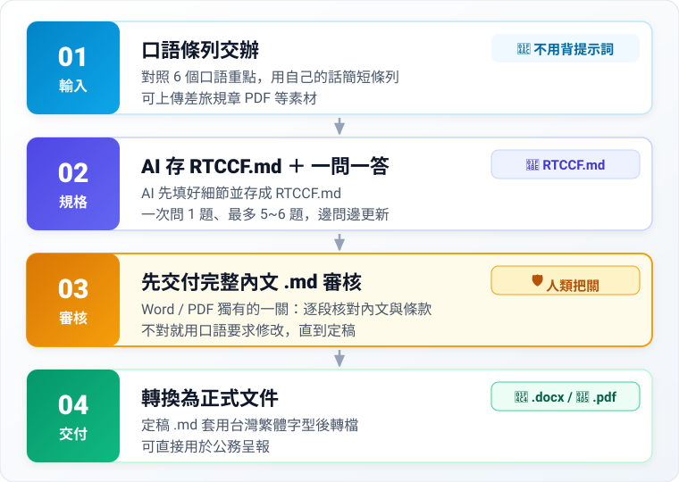

# Word (.docx) 與 PDF (.pdf) 文件生成模組
## 🚀 AI Agent 公文、企劃與報告實戰

> ### 🎯 模組核心目標
> 
> 非技術同仁常面臨公文排版、專案企劃書與法規指引撰寫的繁瑣流程。本模組全面導入 **單點審核 Markdown 閉環機制（RTCCF 任務與預檢規格書二合一）**：
> 
> 1. **零門檻日常口語交辦**：白話口述需求或直接上傳內部規章 PDF，要求 AI 先產出「RTCCF 規格＋預檢卡片」並**強制儲存為 Markdown 檔案（`RTCCF規格書.md`）**交付審核（落實 Human-in-the-Loop）。
> 2. **AI 直接儲存二合一 `RTCCF規格書.md`（單點審核）**：AI 在同一回合將 **RTCCF 任務結構** 與 **章節骨架、字數規劃及合規防線** 儲存為單一 `.md` 檔案交付人類審核，兼具當下審核基準與日後重用範本。
> 3. **正式生成實體文件**：人類單次確認「確認無誤，可以生成」放行後，AI Agent 正式匯出 **Word (.docx)** 與 **PDF (.pdf)**！

---

## 🧭 人機協作標準工作流（Human-in-the-Loop）

---

## 📚 次資料夾實戰範例導覽

本模組收錄兩大核心商業實戰範例，提供完整交辦流程、二合一審核規格書與產出範本：

### 📄 01. 專案企劃書與推動計畫
- **範例連結**：[**01_專案企劃書與推動計畫/**](./01_專案企劃書與推動計畫/README.md)
- **實戰情境**：**口語直接發想**（零門檻日常白話）
- **業務場景**：口語交代重點，由 AI 規劃 1,500 字「2026 年度辦公室 AI 賦能推動計畫書」
- **單點審核交付成果**：
  - 口語輸入 ➔ 二合一 RTCCF 任務與章節架構規格書（單點審核）➔ 產出 [`2026年度辦公室AI賦能推動計畫書_範本.md`](./01_專案企劃書與推動計畫/2026年度辦公室AI賦能推動計畫書_範本.md) ➔ 匯出 `.docx` / `.pdf`

### 📘 02. 企業差旅規章萃取員工指南
- **範例連結**：[**02_企業差旅規章萃取員工指南/**](./02_企業差旅規章萃取員工指南/README.md)
- **實戰情境**：**企業規章萃取**（上傳內部規章 PDF）
- **業務場景**：上傳內部 3 頁差旅管理辦法 PDF，零幻覺提煉差旅報銷標準與加班換休權益指南
- **單點審核交付成果**：
  - 上傳規章 PDF ➔ 二合一 RTCCF 萃取與合規審核規格書（單點審核）➔ 產出 [`員工差旅報銷與加班權益指南_範本.md`](./02_企業差旅規章萃取員工指南/員工差旅報銷與加班權益指南_範本.md) ➔ 匯出 `.docx` / `.pdf`

> 💡 **進階延伸**：若手邊已有一份正式排版之 `.docx` 文件（如結業證書、聘書、公函），需要保護其既有格式、防止字數過長跑版並進行大量批次套印，請參考專案專題：👉 [**Word (.docx) 進階對齊與範本套印**](../../office辦公室應用進階的對齊/docx/README.md)。

---

## 📥 AI Agent 匯出 Word (.docx) 與 PDF (.pdf) 指南

1. **對話介面匯出**：在各主流 AI Agent 對話介面，點選匯出至線上文件或直接複製 Markdown，貼入 Word 保留完整階層排版，並可另存為 PDF。
2. **自主代理 Coding Agent**：可指示 AI Agent 直接讀取工作區內的 `.md` 檔案，透過自動化腳本編譯輸出為標準排版之 `.docx` 或 `.pdf` 實體檔案。

---

[← 返回辦公室全能應用導覽總表](../README.md)
