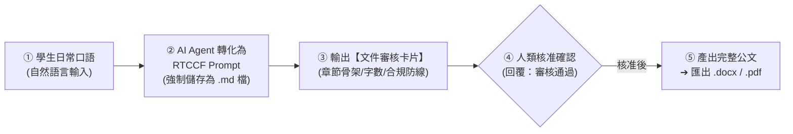

# Word (.docx) 與 PDF (.pdf) 文件生成模組
## 🚀 AI Agent 公文、企劃與報告實戰

> **模組目標**：非技術同仁常面臨公文排版、專案企劃書與法規指引撰寫的繁瑣流程。本模組示範如何透過**「白話自然語言 ➔ RTCCF 提示詞（強制存為 `.md`）➔ 文件審核卡片（人機協商）➔ 正式匯出 Word (.docx) 或 PDF (.pdf)」**，建立高嚴謹度、高效率的公務文件產出閉查。

---

## 🧭 人機協作標準工作流（Human-in-the-Loop）

---

## 📚 次資料夾實戰範例導覽

本模組收錄兩大核心商業實戰範例，提供完整提示詞流程與範例檔案：

| 次範例主題 | 實戰情境類型 | 核心業務場景 | 核心交付成果 |
| :--- | :--- | :--- | :--- |
| **[01. 專案企劃書與推動計畫](./01_專案企劃書與推動計畫/README.md)** | **口語直接發想** | 零門檻口語發想，規劃 1,500 字「2026 年度辦公室 AI 賦能推動計畫書」 | 📄 [`2026年度辦公室AI賦能推動計畫書_範本.md`](./01_專案企劃書與推動計畫/2026年度辦公室AI賦能推動計畫書_範本.md) ➔ 匯出 `.docx` / `.pdf` |
| **[02. 企業差旅規章萃取員工指南](./02_企業差旅規章萃取員工指南/README.md)** | **企業規章萃取** | 上傳內部 3 頁差旅管理辦法 PDF，零幻覺提煉差旅報銷與加班指南 | 📘 [`員工差旅報銷與加班權益指南_範本.md`](./02_企業差旅規章萃取員工指南/員工差旅報銷與加班權益指南_範本.md) ➔ 匯出 `.docx` / `.pdf` |

> 💡 **進階延伸**：若手邊已有一份正式排版之 `.docx` 文件（如結業證書、聘書、公函），需要保護其既有格式、防止字數過長跑版並進行大量批次套印，請參考專案專題：👉 [**Office辦公室應用進階的對齊（Docx 證書與 Xlsx 報價單套印）**](../../office辦公室應用進階的對齊/README.md)。

---

## 📥 AI Agent 匯出 Word (.docx) 與 PDF (.pdf) 指南

1. **對話介面匯出**：在各主流 AI Agent 對話介面，點選匯出至線上文件或直接複製 Markdown，貼入 Word 保留完整階層排版，並可另存為 PDF。
2. **自主代理 Coding Agent**：可指示 AI Agent 直接讀取工作區內的 `.md` 檔案，透過自動化腳本編譯輸出為標準排版之 `.docx` 或 `.pdf` 實體檔案。

---

[← 返回辦公室全能應用導覽總表](../README.md)
