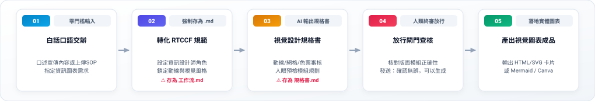
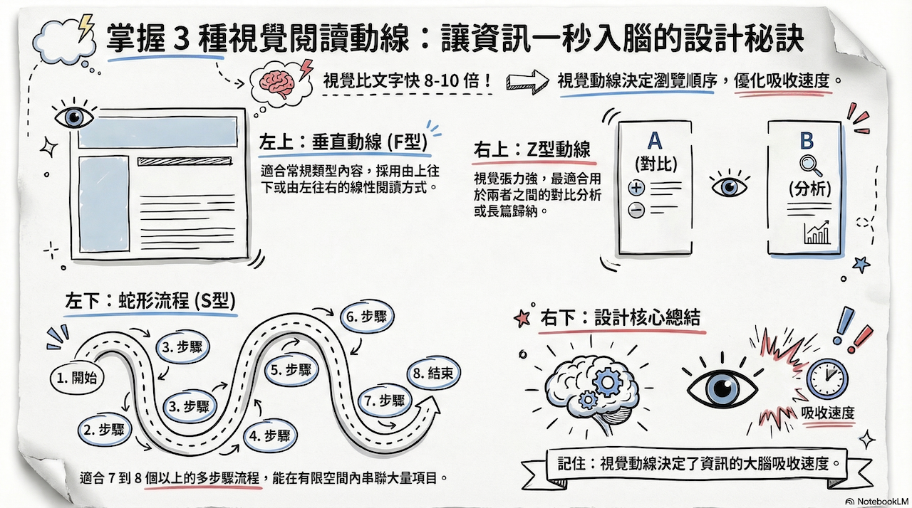

# 全自動資訊圖表 (Infographic) 生成模組
## 🚀 AI Agent 資訊設計實戰（Claude × ChatGPT × Gemini × Antigravity）

> **模組目標**：非技術人員與初學者「完全不必具備設計底子或複雜的 Prompt 技能」！只要說出想要宣傳的白話內容，透過人機協作機制，讓 AI Agent 自動轉化為標準 **RTCCF 格式**並**強制儲存為 Markdown 檔案 (`.md`)**。在正式產出視覺圖表前，強制通過**「視覺設計審核規格書（SVG）」**讓人眼快速核對動線佈局、模組內容與風格配色，待使用者說「可以了」才產出高質感的 **商務資訊圖表（Infographic）** 規格書、SVG 向量代碼或視覺呈現。全面適用於各類主流 AI Agent。

---

## ⚡ 人機協作標準工作流（Human-in-the-Loop）

---

## 📚 次資料夾實戰範例導覽

本模組收錄兩大核心商業實戰範例，提供完整提示詞流程、素材與產出範本：

1. [**實戰範例 01：便當盒排版法：AI協作賦能宣傳圖表**](./01_便當盒排版法_AI協作賦能宣傳圖表/README.md)
   - **情境類型**：白話口語直接發想
   - **核心業務**：日常口語描述痛點，產出 Z 型動線 Bento Box 便當盒一頁式懶人包規格書與 HTML/SVG 視覺卡片。
   - **交付成品**：🖼️ [`便當盒視覺卡片_已完成.html`](./01_便當盒排版法_AI協作賦能宣傳圖表/便當盒視覺卡片_已完成.html)

2. [**實戰範例 02：新人到職SOP指南轉蛇形流程圖解**](./02_新人到職SOP指南轉蛇形流程圖解/README.md)
   - **情境類型**：長篇規章流程視覺化
   - **核心業務**：上傳內部 6 步驟新人到職手冊，自動規劃 S-Curve 蛇形動線並輸出親切明快的流程圖解。
   - **交付成品**：📊 [`新人到職SOP_視覺流程圖解_已完成.html`](./02_新人到職SOP指南轉蛇形流程圖解/新人到職SOP_視覺流程圖解_已完成.html)

---

## 📐 10 大視覺風格與 3 大閱讀動線速查表

### 3 大閱讀動線：
1. **垂直線性動線 (Vertical)**：由上往下延伸，適合列表類內容、單向 SOP 拆解。
2. **Z 型動線 (Z-Pattern)**：左上 ➔ 右上 ➔ 左下 ➔ 右下，適合方案對比與四象限分析。
3. **蛇形流程動線 (S-Curve)**：蛇行蜿蜒前進，適合超過 5 步以上的長條型步驟與時間軸。

---

### 核心視覺風格代表：
- **便當盒法 (Bento Box)**：模組化方格、規整分類，適合功能清單與成效對比。
- **教學風 (Explanatory)**：簡約線條、流程導向，適合員工培訓手冊與 SOP 圖解。
- **專業風 (Professional)**：冷色調、乾淨網格、高對比，適合商務會議與正式年報。
- **積木風 (Blocks)**：幾何方塊、模組化立體視覺，適合系統架構與專案階段。

---

[← 返回辦公室全能應用導覽總表](../README.md)
