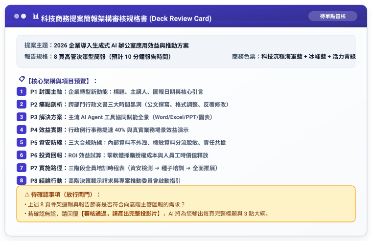

# 步驟 2：AI 一次產出之二合一 RTCCF 簡報企劃與架構規格書

> 💾 **【單點審核核心原則：一次確認，單檔存為 `RTCCF規格書.md`】**  
> *（AI 會在同一則回覆中產出「上半部 RTCCF 條件」＋「下半部 8 頁架構預檢卡片」。學員只需核對這一次，不必分存兩個檔案；日後要寫同類型主管匯報簡報時，也可直接複製本 `.md` 範本一鍵套用！）*

## 📋 上半部：RTCCF 簡報企劃規格

```markdown
## Role（角色）
你是一位曾任職於頂尖科技顧問公司的高階商務簡報架構師與視覺設計總監。

## Task（任務）
規劃一份共 8 頁的「2026 企業導入生成式 AI 辦公室應用效益與推動方案」商業簡報企劃，兼顧高層決策者關注的 ROI、資安防線與落地節奏。

## Context（背景）
報告對象為企業總經理與各部門高階主管，時間僅有 10 分鐘，必須強調精簡、有感、高說服力。

## Constraint（限制與規範）
1. 頁數嚴格限制為 8 頁。
2. 視覺原則：一頁一重點（One Slide, One Idea），每頁條列不超過 3 點，每點不超過 25 字。
3. 附上商務科技色票（主色、強調色、背景色 HEX 色碼）。
4. 為每頁標註【視覺排版建議】與【演講者 30 秒講稿提示】。
5. 人機協作閘門：先與本規格書同步輸出【簡報企劃預檢卡片】，由使用者單次核准後再產出各頁完整細節。

## Format（輸出格式）
完整 8 頁投影片內容與演講備忘錄（Markdown 結構化條列）。
```

## 🛡️ 下半部：簡報企劃架構預檢卡片（單點審核閘門）



---

[← 返回步驟 1](./1-1_白話自然語言發想提示詞.md) ｜ [前往步驟 3：單點審核放行與匯出 →](./1-3_企劃審核卡片與PPTX匯出提示詞.md)
