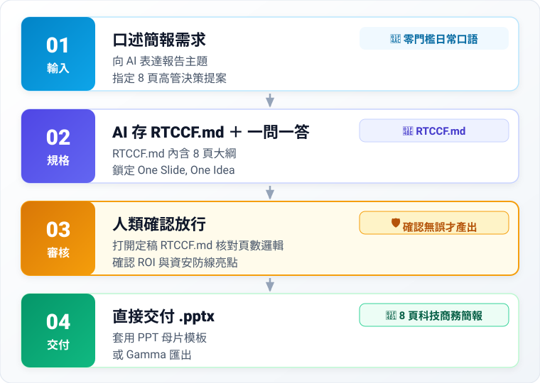

# 實戰範例 01：科技商務提案簡報企劃（PowerPoint）

> 🟢 **適用範圍**：通用於各主流 AI Agent（Web 對話介面與 Coding Agent）  
> 🛠️ **核心工作流**：**口語條列起手 ＋ `RTCCF.md` 輕量一問一答閉環**（口語條列 ➔ AI 存為 `RTCCF.md` 並用 2~3 題問答確認大綱 ➔ 正式生成 PowerPoint 大綱與套版）

---

## 📥 學員實戰素材與交付成品

- **核心交付成品與模板**：
  - [**`商業科技簡報範例.pptx`**](./商業科技簡報範例.pptx) *(完成版 16:9 科技商務簡報投影片)*
  - [**`ptt簡報模版.pptx`**](./ptt簡報模版.pptx) *(開箱即用的科技風商務 PPT 母片模版)*
  - [**`簡報範例元素source/`**](./簡報範例元素source/) *(包含封面頁與內頁 1~3 視覺排版展示圖)*

---

## 🏆 案例情境與業務痛點

同仁需向總經理與各部門一級主管報告「企業導入生成式 AI 辦公室應用」效益：
1. **簡報字數塞滿螢幕**：把報告直接剪貼到投影片上，台上台下都在看小字，失去溝通本質。
2. **缺乏整體架構與色系**：投影片顏色五花八門，沒有科技感商務風格。
3. **頁數失控無法準時講完**：預計 10 分鐘的報告寫了 25 頁，主管沒耐心聽完。

---

## ⚡ 人機協商工作流程（Human-in-the-Loop）



---

## 🛠️ 實戰演練：口語條列 ➔ AI 儲存 `RTCCF.md` ＋ 輕量一問一答 ➔ 實體簡報

學員不需要背誦複雜提示詞，只要用日常口語條列需求，交由 AI 補齊排版色票細節並透過 2~3 題「一問一答」確認大方向：

### 步驟 1：日常口語條列輸入（零門檻起手）

學員只要在對話框中用最自然的條列式寫法輸入需求：

```text
1. 我想做一份跟公司高階主管報告的簡報，主題是「公司今年導入生成式 AI 辦公室應用的效益與推動方案」。
2. 報告時間只有 10 分鐘，預計做 8 頁就好，風格要有科技商務感、字不要太多（每頁最多 3 個重點）。
3. 先不要直接輸出全部投影片內文！請先幫我整理成 RTCCF 規格書，並直接儲存為 Markdown 檔案（RTCCF.md）。
4. 小細節（如配色色碼、排版建議）請你直接用專業經驗幫我填好，只要針對大方向（例如 8 頁分頁大綱與報告切角）用「一問一答」跟我確認（一次問 1 題並給建議選項，不要問太細，最多問 2~3 題就好），每確認一題就幫我更新儲存 RTCCF.md！
```

---

### 步驟 2：與 AI 進行 2~3 題輕量一問一答（動態收斂 `RTCCF.md`）

因為每場匯報情境與現場需求不同，後續對話內容由現場互動決定，學員只需把握兩個重點：
1. **AI 自動建立首版 `RTCCF.md`**：送出後 AI 會先填好科技商務色票、每頁 3 重點上限等排版細節，並將規格儲存為 `RTCCF.md`。
2. **回答 2~3 題大方向問題**：AI 會每次問 1 題（附建議選項 A/B/C，例如確認 8 頁分頁大綱與報告切角），學員只需選擇或簡單補充，AI 即同步更新儲存 `RTCCF.md`。

---

### 步驟 3：確認 `RTCCF.md` 定案 ➔ 下令生成 PowerPoint 內容與套版

回答完 2~3 題並打開確認定稿後的 `RTCCF.md` 無誤，發送放行指令：

```text
RTCCF.md 規格確認無誤，請正式產出完整投影片內容！
```

- 📥 **匯出方式**：
  - **套用現成模板**：下載 [`ptt簡報模版.pptx`](./ptt簡報模版.pptx)，將各頁標題與要項貼入即成！（完成範本見 [`商業科技簡報範例.pptx`](./商業科技簡報範例.pptx)）
  - **Gamma 一鍵生成**：將大綱複製貼入 Gamma，一鍵輸出高品質 16:9 `.pptx` 投影片。

---

[← 返回簡報生成模組](../README.md)
