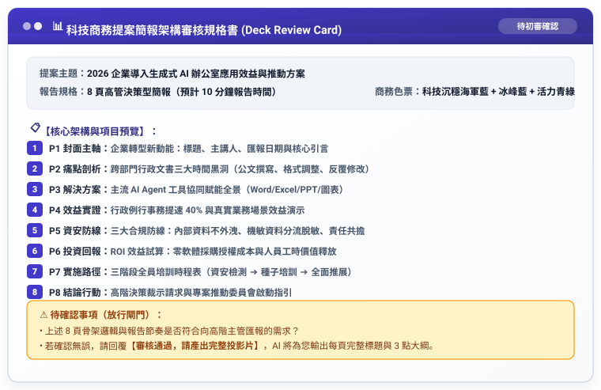

# 實戰範例 01：科技商務提案簡報企劃（PowerPoint）

> 🟢 **適用範圍**：通用於各主流 AI Agent（Web 對話介面與 Coding Agent）  
> 🛠️ **核心工作流**：**雙階段 Markdown 審核閉環**（口語發想 ➔ 存為 `工作流.md` 初審 ➔ 產出 `規格書.md` 終審 ➔ 正式生成 PowerPoint 大綱與套版）

---

## 📥 學員實戰素材與交付成品

- **核心交付成品與模板**：
  - [**`商業科技簡報範例.pptx`**](./商業科技簡報範例.pptx) *(完成版 16:9 科技商務簡報投影片)*
  - [**`ptt簡報模版.pptx`**](./ptt簡報模版.pptx) *(開箱即用的科技風商務 PPT 母片模版)*
  - [**`簡報範例元素source/`**](./簡報範例元素source/) *(包含封面頁與內頁 1~3 視覺排版展示圖)*

---

## 🏆 案例情境與業務痛點

同仁需向總經理與各部門一級主管報告「企業導入生成式 AI 辦公室應用」效益：
1. **簡報字數塞滿螢幕**：把報告直接剪貼到投影片上，台上台下都在看小字，失去溝通本質。
2. **缺乏整體架構與色系**：投影片顏色五花八門，沒有科技感商務風格。
3. **頁數失控無法準時講完**：預計 10 分鐘的報告寫了 25 頁，主管沒耐心聽完。

---

## ⚡ 人機協商工作流程（Human-in-the-Loop）


---

## 🛠️ 實戰演練：自然語言 ➔ RTCCF 交辦事項 ➔ 規格書 ➔ 實體簡報

學員不必在多個檔案間切換，以下完整展示從白話日常口語到生成最終投影片的完整流程：

### 步驟 1：日常自然語言輸入（零門檻口述需求）

學員只要在對話框中輸入日常白話：

```text
我想做一份跟公司大主管報告的簡報，大概 8 頁就好。主題是我們公司今年要導入生成式 AI 辦公室應用的好處，風格要有科技感但簡約專業，不要太多字，每頁最多 3 個重點。
請先幫我把這段需求改寫成標準的 RTCCF 交辦事項（工作流），讓我儲存為 Markdown (.md) 檔案；並且先產出「簡報企劃架構規格書」給我確認，不要直接輸出全部投影片。待我確認 Markdown 內容與架構後，請再依照該檔為我正式生成各頁詳細內容。
```

---

### 步驟 2：AI Agent 轉化為 RTCCF 交辦事項（⚠️ 強制儲存為 `工作流.md`）

AI Agent 接收口語後，自動結構化出標準交辦事項。**請學員第一時間將此內容儲存為 `科技簡報企劃_工作流.md` 檔案**：

```markdown
## Role
資深管理顧問兼高階商務簡報教練。

## Task
規劃一份「2026 企業導入生成式 AI 辦公室應用效益」的 8 頁高管決策型簡報企劃。

## Context
聽眾為總經理與各部門一級主管，匯報時間限時 10 分鐘，著重決策效益與風險防線。

## Constraint
1. 嚴格限定 8 頁，每頁文字遵循「One Slide, One Idea」，最多 3 點精煉要項。
2. 配置科技沉穩商務色系（海軍藍、冰峰藍、活力青綠）。
3. 執行限制：【第一步必須先產出審核規格書】，待使用者核准後再輸出全文。
4. 語言：繁體中文，公務商務正式口吻。

## Format
階層標題（Markdown #、##、###）、每頁標題與 3 點綱要。
```

> 👤 **人類初審**：使用者在本地或專案中檢視 `工作流.md`，可隨時微調受眾或重點頁數，確認無誤後傳給 AI 執行。

---

### 步驟 3：傳遞工作流 ➔ AI Agent 輸出「簡報企劃架構規格書」（⚠️ 亦存為 `規格書.md`）

AI Agent 接獲交辦事項後，先輸出 8 頁架構規格書供人類查核：



---

### 步驟 4：人類終審放行 ➔ 正式生成 PowerPoint 內容與套版

使用者人眼核對 8 頁主題骨架與商務色票完全符合預期後，發送放行指令：

```text
審核通過，請產出完整投影片。
```

AI Agent 立即依循規格書輸出完整 8 頁投影片內容：
- 📥 **匯出方式**：
  - **套用現成模板**：下載 [`ptt簡報模版.pptx`](./ptt簡報模版.pptx)，將標題與要項貼入即成！
  - **Gamma 一鍵生成**：將大綱複製貼入 Gamma，一鍵輸出高品質 16:9 `.pptx` 投影片。

---

[← 返回簡報生成模組](../README.md)
