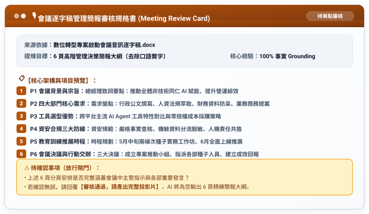

# 步驟 2：AI 儲存 `RTCCF.md` 規格書 ＋ 輕量一問一答確認大方向

> 💾 **【Human-in-the-Loop 核心原則：AI 存為 `RTCCF.md` ＋ 最多 2~3 題大方向確認】**  
> *（AI 會自動依逐字稿補齊事實查核規範與精簡格式等小細節，直接儲存為單一 `RTCCF.md` 實體檔案；並只針對 6 頁決策主題與關鍵決議用「一次 1 題＋建議選項」跟學員確認，每答一題同步更新儲存 `RTCCF.md`。日後週會／月會要整理會議記錄時，也可直接複製這份 `RTCCF.md` 一鍵套用！）*

## 📋 AI 產出並儲存之 `RTCCF.md` 逐字稿提煉規格

```markdown
## Role
企業內部高階管理幕僚兼簡報總監。

## Task
以上傳之《星雲數位 2026 智慧辦公室啟動會議逐字稿》為單一事實來源，提煉出 6 頁高階管理決策簡報大綱。

## Context
針對跨部門利害關係人，將長達數千字之會議錄音萃取為直擊核心的投影片。

## Constraint
1. 嚴格依據會議逐字稿事實，不加油添醋。
2. 共 6 頁，每頁提煉 3 項核心決策點。
3. 執行限制：小細節依逐字稿與專業慣例自動補齊，僅針對 6 頁分頁主題與關鍵決議摘要透過「一問一答（一次 1 題、附選項、最多 2~3 題）」確認，確認後同步更新本 `RTCCF.md` 再展開各頁細節。

## Format
6 頁結構化投影片內容與決策要項（Markdown 格式）。
```

## 🛡️ 一問一答確認大方向：6 頁決策簡報預檢總覽

AI 在一問一答中會將以下提煉骨架與決議要點提供給學員確認（最多 2~3 題，不問太細）：



---

[← 返回步驟 1](./2-1_白話自然語言發想提示詞.md) ｜ [前往步驟 3：確認 `RTCCF.md` 放行與生成 →](./2-3_逐字稿簡報審核卡片與投影片生成提示詞.md)
