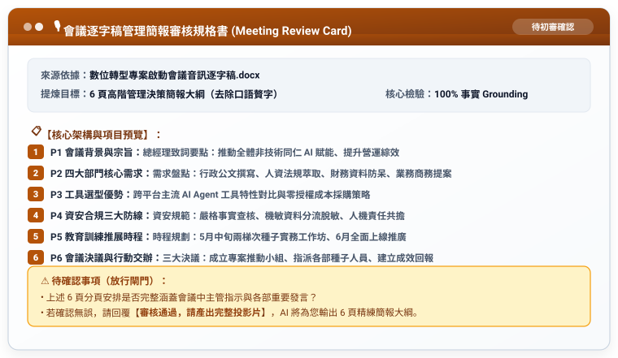

# 步驟 3：逐字稿簡報審核卡片與投影片生成提示詞

## 🛡️ 人機協商閘門：AI 產出的「逐字稿簡報審核卡片」

在展開詳細投影片前，AI 呈現規格書供人類核准：



---

## 💬 人類核准指令

```text
審核通過，請產出完整投影片。
```

---

## 📥 匯出 PowerPoint (.pptx)

回覆審核通過後，AI 輸出每頁精練重點，學員可套用現成模板或貼入 Gamma 匯出 `.pptx`。

產出成果請參閱：[**`數位轉型專案啟動會議_管理簡報大綱.md`**](./數位轉型專案啟動會議_管理簡報大綱.md)。

---

[← 返回步驟 2](./2-2_AI產出之RTCCF逐字稿提煉提示詞.md) ｜ [返回範例導覽](./README.md)
