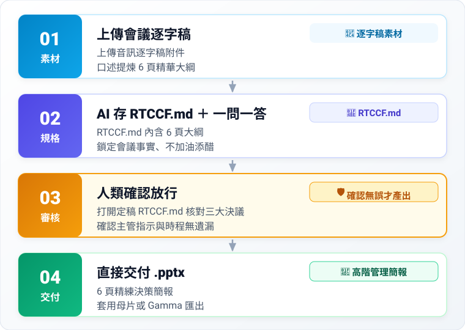
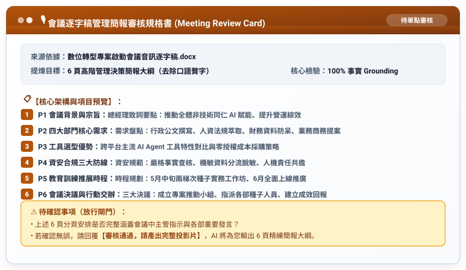

# 實戰範例 02：會議錄音逐字稿萃取管理簡報（PowerPoint）

> 🟢 **適用範圍**：通用於各主流 AI Agent（Web 對話介面與 Coding Agent）  
> 🛠️ **核心工作流**：**口語條列起手 ＋ `RTCCF.md` 輕量一問一答閉環**（上傳逐字稿 ＋ 口語條列 ➔ AI 存為 `RTCCF.md` 並用 2~3 題問答確認重點 ➔ 正式生成高階管理簡報）

---

## 📥 學員實戰素材與交付成品

- **必載輸入素材**：
  - [**`素材_數位轉型專案啟動會議音訊逐字稿.docx`**](./素材_數位轉型專案啟動會議音訊逐字稿.docx) *(長篇會議逐字稿，亦可使用 [純文字檔](./素材_數位轉型專案啟動會議音訊逐字稿.txt))*
- **核心交付成品**：
  - [**`數位轉型專案啟動會議_管理簡報大綱.md`**](./數位轉型專案啟動會議_管理簡報大綱.md) *(由 AI 去蕪存菁提煉之 6 頁高階管理決策投影片大綱，可一鍵轉為 `.pptx`)*

---

## 🏆 案例情境與業務痛點

高階主管會議動輒開 2 小時，產生數萬字音訊逐字稿：
1. **逐字稿又長又雜**：充滿口語助詞、跨部門發散討論，老闆沒時間閱讀全文。
2. **缺乏結構化決策點**：無法快速提煉出「總經理指示、各部需求、資安防線、培訓時程」。
3. **AI 隨意歸納容易漏看**：若未先透過 `RTCCF.md` 與一問一答確認大綱方向，容易遺漏關鍵交辦事項。

---

## ⚡ 人機協商工作流程（Human-in-the-Loop）



---

## 🛠️ 實戰演練：口語條列 ➔ AI 儲存 `RTCCF.md` ＋ 輕量一問一答 ➔ 實體簡報

學員不需要背誦複雜提示詞，只要上傳逐字稿並用日常口語條列需求，交由 AI 過濾雜訊並透過 2~3 題「一問一答」確認大方向：

### 步驟 1：日常口語條列輸入（零門檻起手）

在對話介面上傳 [`素材_數位轉型專案啟動會議音訊逐字稿.docx`](./素材_數位轉型專案啟動會議音訊逐字稿.docx)，並用日常條列式輸入需求：

```text
1. 請幫我把剛才上傳的「數位轉型會議錄音逐字稿」，整理成一份給老闆看的精華管理簡報大綱，大約 6 頁。
2. 我希望把總經理講的話、各部門需求、資安怎麼管、什麼時候培訓跟最後三大決議提煉出來，口語廢話要濾掉。
3. 先不要直接輸出全部投影片內容！請先幫我整理成 RTCCF 規格書，並直接儲存為 Markdown 檔案（RTCCF.md）。
4. 小細節請你直接依逐字稿幫我規劃好，只要針對大方向（例如 6 頁分頁主題與關鍵決議摘要）用「一問一答」跟我確認（一次問 1 題並給建議選項，不要問太細，最多問 2~3 題就好），每確認一題就幫我更新儲存 RTCCF.md！
```

---

### 步驟 2：AI 儲存 `RTCCF.md` ＋ 輕量一問一答（只問 2~3 題大方向）

AI Agent 接收口語與附件後，會自動依逐字稿補齊事實查核規範並儲存 **`RTCCF.md`**，同時拋出 2~3 題附選項的大方向問題（確認 6 頁分頁主題與三大決議重點），每回答一題即自動更新儲存 `RTCCF.md`：

**【AI 產出並儲存的 `RTCCF.md` 範例】**

```markdown
## Role
資深企業幕僚兼決策簡報顧問。

## Task
以已上傳之《數位轉型專案啟動會議音訊逐字稿》為客觀依據，提煉出 6 頁高階管理決策簡報大綱。

## Context
供總經理與各部門主管查閱，著重會議決議、部門權責與行動方針。

## Constraint
1. 嚴格依據逐字稿客觀事實，去除發散對話與口語贅字。
2. 提煉總經理致詞重點、四部需求、資安原則、訓練時程與三大決議。
3. 執行限制：小細節依逐字稿與專業慣例自動補齊，僅針對 6 頁分頁主題與關鍵決議摘要透過「一問一答（一次 1 題、附選項、最多 2~3 題）」確認，確認後同步更新本 `RTCCF.md` 再輸出全文。
4. 語言：繁體中文，精準洗鍊。

## Format
6 頁結構、每頁核心標題與 3 點決策綱要。
```

**【AI 透過一問一答確認的大方向預檢總覽】**



> 👤 **輕量 Human-in-the-Loop（不問太細）**：AI 主動附上建議選項，學員只要花 30 秒回答 2~3 題確認 6 頁決策結構未遺漏關鍵交辦事項，AI 即更新儲存定版 **`RTCCF.md`**，這份 `.md` 也能作為團隊週會／月會固定套用的萃取範本！

---

### 步驟 3：人類確認放行 ➔ 正式生成 PowerPoint 內容與套版

一問一答完成且打開確認定稿後的 `RTCCF.md` 無誤，直接發送放行指令：

```text
RTCCF.md 規格確認無誤，請正式產出完整投影片內容！
```

AI Agent 立即依循規格書輸出完整 6 頁管理簡報大綱：
- 📄 **完整示範成果**：請直接點閱參閱 [**`數位轉型專案啟動會議_管理簡報大綱.md`**](./數位轉型專案啟動會議_管理簡報大綱.md)。
- 📥 **匯出方式**：可直接套用現成 PPT 母片模板或貼入 Gamma 匯出高品質 `.pptx` 投影片交付長官！

---

[← 返回簡報生成模組](../README.md)
