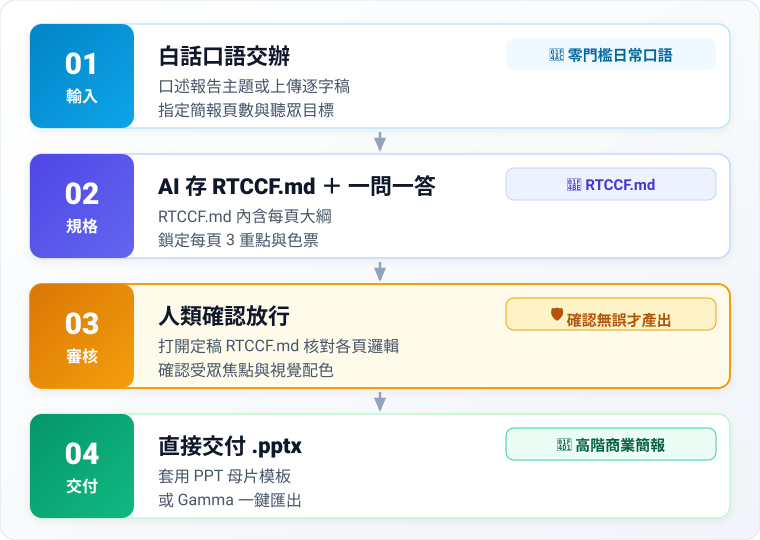

📍 [常見的 AI 應用](../../README.md) › [辦公室全能應用](../README.md) › **PowerPoint 簡報**

# PowerPoint (.pptx) 簡報生成模組
## 🚀 AI Agent 商業簡報大綱萃取與 PPTX 實戰（Claude × ChatGPT × Gemini × Antigravity）

> 💡 **簡報交付原則**：`RTCCF.md` 內就已包含每頁大綱，所以不需要中間的 `.md` 內文檔，大綱經一問一答確認後就直接交付 `.pptx`。

---

## ⚡ 人機協作標準工作流（Human-in-the-Loop）

---

## 📚 次資料夾實戰範例導覽

本模組收錄兩個實戰範例，建議依序閱讀：

1. [**範例 01：科技商務提案簡報企劃**](./01_科技商務提案簡報企劃/README.md)：零門檻口語發想，產出 8 頁「企業導入生成式 AI 效益」提案簡報，可套用 PPT 模版。
2. [**範例 02：會議錄音逐字稿萃取管理簡報**](./02_會議錄音逐字稿萃取管理簡報/README.md)：上傳數千字會議逐字稿，萃取 6 頁高層決策簡報。

---

## 🎨 科技商務配色與設計原則

- **深邃科技風**：主色深藍 `#1E2761`、強調色冰藍 `#CADCFC` 或青綠 `#00FFD0`。
- **閱讀黃金法則**：**一頁一重點（One Slide, One Idea）**，切忌將長段落文字直接複製到簡報上。
- **排版技巧**：文字盡量採用「**粗體關鍵字** + 簡要短語」，讓台下主管在 3 秒內抓住核心論點。
- **跨平台統一字型**：在 `RTCCF.md` 指定中文 `Microsoft JhengHei`（或 `Noto Sans TC`）、英數 `Arial`，細節見[共通工作流](../00_共通工作流/README.md)的「跨平台統一字型」。

---

🧭 [⬅ 上一頁：Excel 試算表](../Excel試算表的生成/README.md) ｜ [⬆ 回到：辦公室全能應用](../README.md) ｜ [下一頁：範例素材與偽資料 ➡](../範例素材與偽資料/README.md)
